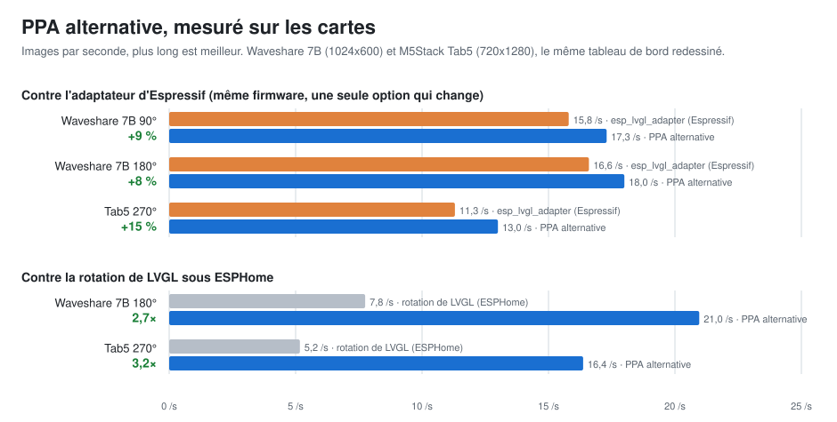

# ppa-alternative — `lv_draw_ortho`

**A turned LVGL screen on an ESP32-P4, drawn in the panel's own orientation:
LVGL draws, the PPA turns, and nothing is turned a second time.**

A panel used the other way round from how it was built — a Tab5 or a Guition
in landscape, a Waveshare upside down — costs LVGL two passes today: it draws
the screen upright, then turns the finished picture into the frame buffer.
LVGL 9 has the right idea already (`lv_display_set_matrix_rotation()` hands
each draw task a matrix), but its software renderer and its PPA unit ignore
that matrix. **`lv_draw_ortho` is a draw unit that reads it.**
`components/lvgl_ortho` puts it on an ESPHome board, and
[esp-iot-solution PR #818](https://github.com/espressif/esp-iot-solution/pull/818)
puts it in Espressif's own `esp_lvgl_adapter`.



## Measured on the boards

Two ESP32-P4 boards, the same dashboard on both (text, cards with borders and
shadows, a gradient, an arc, a bar, a slider, a switch), redrawn whole for
ten seconds:

| board | chip | panel | turned |
|---|---|---|---|
| Waveshare ESP32-P4-WIFI6-Touch-LCD-7B | rev 1.3 | EK79007 1024x600 | 90 and 180 |
| M5Stack Tab5 | rev 1.0 | ILI9881C 720x1280 | 270 (landscape) |

### Against Espressif's own rotation

Espressif's `esp_lvgl_adapter` already draws a turned screen in strips in
internal RAM and turns each strip with the PPA while the next is drawn
(`TRIPLE_PARTIAL`, its default on a MIPI DSI panel). PR #818 adds
`CONFIG_ESP_LVGL_ADAPTER_ROTATE_IN_DRAW`, which is `lv_draw_ortho` with two
cores and the panel's three frame buffers. Measured through the adapter's own
test app (`test_apps/lvgl9`), the same firmware built twice but for that one
option, ESP-IDF v5.5.5, two runs each:

| | Espressif today | PPA alternative | |
|---|---|---|---|
| Waveshare 7B, 90 | 15.8 /s, 63.4 ms (worst 64.9) | **17.2 - 17.3 /s, 57.5 - 58.2 ms (worst 59.2)** | **+9 %** |
| Waveshare 7B, 180 | 16.6 /s, 59.4 - 59.7 ms (worst 60.8) | **18.0 /s, 54.9 - 55.2 ms (worst 56.4)** | **+8 %** |
| Tab5, 270 | 11.3 /s, 81.5 ms (worst 103) | **12.9 - 13.0 /s, 77.0 - 77.5 ms (worst 78)** | **+15 %** |
| Tab5, 270, ESP-IDF's default L2 cache | 11.2 /s, 81.6 ms (worst 103) | **17.9 - 18.0 /s, 53.3 - 54.4 ms (worst 55)** | **+61 %** |
| Waveshare 7B, 90, ESP-IDF's default L2 cache | 15.5 - 15.6 /s, 63.5 - 64.1 ms (worst 64.9) | **23.3 - 23.4 /s, 42.4 - 42.6 ms (worst 43.5)** | **+50 %** |
| Waveshare 7B, 180, ESP-IDF's default L2 cache | 16.7 /s, 59.4 - 59.7 ms (worst 60.8) | **25.9 - 26.1 /s, 38.2 ms (worst 38.8)** | **+56 %** |

Frames a second is the figure to compare: Espressif's path also loses about
7 ms between frames on the Tab5, which its time per frame does not show. Same
frame buffers in both columns (three), and every one of the test app's tests
passes in every run. On the Tab5, **ESP-IDF v6.1** gives the same: 13.0 - 13.2
/s, 75.8 - 76.9 ms.

The last three rows are the same firmwares built with ESP-IDF's default L2
cache, 128 KB, where the test app sets 256 KB: Espressif's path does not move,
the PPA alternative gains 35 to 44 %. See [The L2 cache size](#the-l2-cache-size)
below.

**What the turn itself costs.** An earlier build of the Espressif firmware
ran at rotation 0 by mistake: 18.4 /s, 47.0 - 47.5 ms, which is this screen
drawn with no turn at all. Over that, turning the Waveshare costs Espressif
16 ms at 90 and 12 ms at 180, and the PPA alternative 11 and 8 -- **about a
third less**.

**Why three frame buffers.** A first version of the PR drew into two and was
*slower* at 90, 66.1 ms (15.1 - 15.2 /s): it drew a frame in 58.4 ms, then
waited for the panel to switch buffers on its next refresh, so on a 60 Hz panel
every frame was rounded up to four refreshes. With three, LVGL draws the next
frame into the third while the panel waits, and a frame costs what drawing it
costs. The buffer LVGL draws into is then two frames old: LVGL brings over the
frame before (`refr_sync_areas`), and the adapter copies the frame before that
from its diff tracker, less what is about to be drawn again.

### Against ESPHome's LVGL rotation

Through ESPHome (`components/lvgl_ortho`, ESPHome 2026.12.0-dev with
youkorr/lvgl_9.5), timed by `lvgl_bench` from `RENDER_START` to
`REFR_READY`. ESPHome's LVGL draws the screen upright, then turns it, one
after the other:

| | Tab5, 270 | Waveshare 7B, 180 |
|---|---|---|
| LVGL's own rotation | 193.6 ms | 129.0 ms |
| the same, the fork's PPA unit (`use_ppa`, `use_ppa_img`) | 176.1 ms | |
| lvgl_ortho, the CPU turning (`ppa: false`) | 177 ms | |
| lvgl_ortho, 1 core, frame copied to the panel | 78.5 ms | |
| lvgl_ortho, 2 cores, frame copied to the panel | 71.0 ms | |
| lvgl_ortho, 1 core, the panel's own frame buffers | | **57.0 ms** (2.3x) |
| lvgl_ortho, 2 cores, the panel's own frame buffers (`framebuffers: 3`) | **61.1 ms** (3.2x) | **47.7 ms** (2.7x) |

On the Tab5, the PPA turning 1280x720 is most of a frame: a quarter turn
runs at 15-18 Mpx/s on this chip (16x16 macro blocks below rev 3.0), which is
51-61 ms for the whole screen, and the drawing on both cores is hidden behind
it. Where in that range a frame lands depends on the tiles' size: through the
adapter with more internal RAM it was 54.4 ms (see the L2 cache below). `pixel_mode: 16` and `24`
measure the same, and narrower tiles were slower (see `tile_width:` below).
At 180 the turn is the PPA's easy case (about 41 Mpx/s), so on the Waveshare
what is left is drawing the UI; the second core gains 16 %.

### The L2 cache size

It is most of the gap between the adapter and ESPHome. The ESPHome
figures were lower than the adapter's on the same board (61 against 77 ms on
the Tab5). The adapter's test app sets its L2 cache to 256 KB
(`sdkconfig.defaults.esp32p4`), where ESP-IDF's default is 128 KB, and every
KB of cache is a KB less of internal RAM: the heap's main internal block is
256 KiB with 256 KB of cache and 384 KiB with 128 KB. `lv_draw_ortho` draws
its tiles in internal RAM and cuts them out of whatever blocks fit there, so
with more of it the tiles are bigger and there are fewer of them to turn. The
same firmwares, built with 128 KB of L2 cache (`l2_cache: 128` in the workflow
below), ESP-IDF v5.5.5; the boot log's main internal block reads 384 KiB:

| | 256 KB of L2 cache (the test app's) | 128 KB (ESP-IDF's default) |
|---|---|---|
| Tab5, 270, PPA alternative | 12.9 - 13.0 /s, 77.0 - 77.5 ms | **17.9 - 18.0 /s, 53.3 - 54.4 ms (worst 55.2)** |
| Tab5, 270, Espressif today | 11.3 /s, 81.5 ms (worst 103) | 11.2 /s, 81.6 ms (worst 103) |
| Waveshare 7B, 90, PPA alternative | 17.2 - 17.3 /s, 57.5 - 58.2 ms | **23.3 - 23.4 /s, 42.4 - 42.6 ms (worst 43.5)** |
| Waveshare 7B, 90, Espressif today | 15.8 /s, 63.4 ms | 15.5 - 15.6 /s, 63.5 - 64.1 ms (worst 64.9) |
| Waveshare 7B, 180, PPA alternative | 18.0 /s, 54.9 - 55.2 ms | **25.9 - 26.1 /s, 38.2 ms (worst 38.8)** |
| Waveshare 7B, 180, Espressif today | 16.6 /s, 59.4 - 59.7 ms | 16.7 /s, 59.4 - 59.7 ms (worst 60.8) |

Espressif's path does not move with the cache size, on either board. The PPA
alternative gains 35 to 44 %, is faster than through ESPHome (61.1 ms on the
Tab5, 47.7 at 180 on the Waveshare), and at ESP-IDF's default gives **50 to
61 % more frames a second than Espressif's own rotation**. On the Waveshare a
frame drawn is a frame shown: the drawing alone is 42.3 ms at 90 against 42.4
for the whole frame, because with three frame buffers nothing waits for the
panel. Every test of the app passes in every run, and the heap moves by about
as much with the option as without it (88 to 656 bytes a test, under the
test's 2000).

### The cameras

Each board's own sensor, as its YAML in
[youkorr/esphome_esp-video](https://github.com/youkorr/esphome_esp-video)
sets it up. A sensor's lanes and frame rate belong to the format the driver
picks, so the sensor's rate is the ceiling the display has to keep up with:

| board | panel, turn | sensor | format | lanes | the sensor sends |
|---|---|---|---|---|---|
| M5Stack Tab5 | 720x1280, 270 | SC2356 (SC202CS silicon) | RAW8 1280x720, the whole frame shown | 1 | 30 /s |
| Waveshare 7B | 1024x600, 180 | OV5647 | RAW10 1280x960 binned, its centre 1024x600 shown | 2 | 45 /s (the YAML asks 30) |
| Guition 10" | 800x1280, 90 | OV02C10 | RAW10 1288x728, its centre 1280x720 under 80 px of UI | 1 | 30 /s |

**Measured on the boards**, the camera on the whole screen, each frame drawn
by LVGL as a picture and turned once by the PPA (`lvgl_camera_display`):

| | Tab5, SC2356 | Waveshare 7B, OV5647 |
|---|---|---|
| LVGL's own rotation | 10-12 /s | |
| lvgl_ortho, frame copied to the panel (ESPHome's `mipi_dsi`) | 12.8 /s | |
| lvgl_ortho, the panel's own frame buffers | **15.6 /s** | **20.8 /s** |
| the same, the turn split between the PPA and both cores (`split:`) | 14.0 /s | |
| the panel's own frame buffers, ESPHome's main loop kept awake | | **26.2 /s** (LVGL's own counter 26-28) |

On the Tab5 the copy to the panel is 14.4 ms a frame, which is the whole
difference between the second and third rows. The sensor at 30 frames a
second against 20 changed nothing (15.6 against 15.3), so on the Tab5 the
display is the limit, not the sensor: about half of what the SC2356 sends
reaches the screen. The Guition's camera has not run with lvgl_ortho.

**On the Waveshare the last 20 % was ESPHome's main loop sleeping.** The
camera is taken from the main loop (`esp_video_camera` polls its capture
queue there), and that loop sleeps up to 16 ms between passes unless
something wakes it, so a frame ready meanwhile waits. The same firmware read
**25** frames a second with `esp-idf: DEBUG` and **20** at WARN, with
lvgl_ortho turning exactly one picture of 1200 KiB a screen in both: the
ISP's DEBUG lines, one or two a frame, were what woke the loop (ESPHome's
logger wakes it for a line from another task). Per frame the work was the
same, about 35 ms; at WARN about 15 ms more was the loop asleep. Held awake
with ESPHome's `HighFrequencyLoopRequester`, at WARN, it reads **26.2
screens/s**. The two lines that do it, in a board's YAML:

```yaml
esphome:
  on_boot:
    then:
      - lambda: |-
          static esphome::HighFrequencyLoopRequester fast_loop;
          fast_loop.start();
```

Measured with `esp_video_camera` and `lvgl_camera_display` from
youkorr/esphome (branch `esp_video_camera-lvgl`), OV5647 at 1280x960, ESPHome
2026.12.0-dev. The Tab5 has not been run this way.

**Tested on a PC at the sensors' real sizes.** `test/` has the three boards
as cases, with their sensor's frame, their panel and their turn: the screen
with the frame written by the (fake) PPA must be, pixel for pixel, the screen
LVGL draws with that crop of the frame as an ordinary image. All three pass:

```
ok    M5Stack Tab5, SC2356: 1280x720 sensor frame into the 720x1280 panel at 90
ok    Guition 10", OV02C10: 1288x728 sensor frame cropped into the 800x1280 panel at 270
ok    Waveshare 7", OV5647: 1280x960 sensor frame cropped into the 1024x600 panel at 180
```

The angles there are LVGL's: ESPHome counts its quarter turns the other way,
so its 270 is LVGL's 90. Besides those three, the camera has 45 more cases:
frames upright and already turned, smaller and bigger than the screen, cut,
mirrored, at every angle, through the PPA into the panel's own buffers.

**ESP-IDF v5.5.6.** All the camera figures above are ESP-IDF v5.5.5. On
v5.5.6 the camera of an ESP32-P4 below rev 3.0 did not start at all
(`esp_cam_new_csi_ctlr: failed to configure format conversion`): v5.5.6
takes the CSI bridge's input colour to be the ISP's output, and esp_video
still handed it the sensor's RAW format, so the bridge was asked for a
conversion that only rev 3.0 can do. esphome_esp-video carries the fix
(commit 26e1be9), and so does Espressif's esp-video-components (79ae611),
which no esp_video release carries yet. Nothing in lvgl_ortho changes.

### Not measured yet

- **The Guition JC8012P4A1** (800x1280, 90): only simulated, see
  [How it is measured](#how-it-is-measured); its OV02C10 camera only in the
  tests.
- **ESP32-P4 rev 3.0**, where the PPA's quarter turn works in 32x32 blocks
  rather than 16x16: neither board here has one. PR #818 now carries a test
  that runs it on Espressif's CI board.
- **RGB panels**: the adapter path supports them and has never run on one.
- **Pictures turned once** (`image_cache:`) and **a big turn split**
  (`split:`): `split:` was measured on the Tab5 and was slower (below);
  `image_cache:` only in simulation.

## On an ESPHome board

Two lines change in a board's YAML: `rotation:` leaves the `lvgl:` block and
goes on `lvgl_ortho:`, with the same number.

```yaml
external_components:
  - source: github://youkorr/ppa-alternative-@main
    components: [lvgl_ortho]

lvgl:
  # no rotation: here any more
  buffer_size: 100%

lvgl_ortho:
  id: ortho
  rotation: 270           # what lvgl: had (ESPHome's degrees, clockwise)
  # ppa: true             # the default: the PPA turns while the CPU draws
  # cores: 2              # off by default: the second core draws every other tile
  # image_cache: 4MB      # the default: pictures that do not change are turned once
  # tile_width: 256       # off by default: narrower, taller tiles (slower on a Tab5)
  # split: true           # off by default: the PPA and the CPU together (slower on a Tab5)
```

It takes LVGL's display over once ESPHome's lvgl has built it: one
panel-sized buffer in the panel's orientation, a flush that copies only the
rows that changed, and touches turned back to the screen's coordinates.

- **The panel's own frame buffers.** With youkorr/lvgl_9.5's `mipi_dsi` and
  `framebuffers: 3`, LVGL draws straight into the buffer the panel will show
  and a finished frame is a pointer swap: nothing copied, nothing torn.
  Nothing to set; the boot log says which way it draws.
  `example/guition-lvgl-ortho-panel-buffers.yaml` is a whole board.
- **The camera.** `show_video(obj, frame, w, h)` turns a frame with one PPA
  pass into a window of the frame buffer LVGL keeps out of. In
  youkorr/esphome_esp-video's `lvgl_camera_display` that is one line,
  `ortho_id: ortho`. `example/guition-lvgl-ortho.yaml` is a whole board.
- **`ppa: false`** turns with the CPU instead, to compare.
- **`image_cache:`** is the PSRAM kept for pictures turned once (see
  [Pictures turned once](#pictures-turned-once)); `0` turns it off.
- **`tile_width:`** caps how wide a tile is drawn, so it is taller instead.
  At 90 and 270 a tile's height is the length of each row the PPA writes:
  a whole-width tile of 1280 is 51 rows high, so the turner writes rows of 51
  pixels; at 256 it writes rows of 256. On a Tab5 it is slower: 73.8 ms
  at 256 and 82.2 at 128 with 2 cores against 71.0, and 111.0 at 128 with
  one against 78.5. Part of the cost is per tile, not per pixel -- LVGL
  draws each task once per tile it touches, and each tile is one more PPA
  transaction and one more wait. `0`, the default, keeps the widest tiles.
- **`split: true`** shares a big picture's quarter turn (a camera frame, a
  wallpaper) between the PPA and the CPU, see [A big turn split](#a-big-turn-split).
- **`cores: 2`** draws every other tile on the second core (see
  [Two cores](#two-cores)). It needs LVGL built with an OS, which
  youkorr/lvgl_9.5 is, and is refused otherwise.

Every ten seconds the log says how much was turned, how much of it the PPA
did, how often the CPU waited for it, and how many tiles the second core drew,
then what the turned bytes were:

```
  turned 23040 KiB/s, 100% of it by the PPA, the CPU waited 38.4 times/s for it
    of it: pictures 22800 KiB/s (1.00 a screen, 1200 KiB each), tiles out 120 KiB/s, read back under tiles 120 KiB/s
    pictures: 19.0/s, 0.0/s the same one again, 0.0/s into a layer; 19.2 refreshes/s drawn
```

A picture is a camera frame or a wallpaper drawn by LVGL. More than one a
screen, or more KiB each than the part of it on the glass (1200 KiB for a
1024x600 screen in RGB565), is the same frame drawn twice; read-back is what
lay under tiles of a part of the screen drawn again. The last line says
where a second picture would come from: the same frame turned again, a
picture drawn into one of LVGL's layers and again as the layer, or refreshes
drawn and never shown (more refreshes than screens shown). (The figures above
are an example of the shape, not a measurement.)

## Testing it on the three boards

`yaml/test-lvgl.yaml` is one small firmware for all three boards: an
ordinary interface (text, cards with borders and shadows, a gradient, an arc,
a bar, a slider, a switch) and `lvgl_bench`. Two words at its top choose
everything:

```yaml
substitutions:
  board: tab5     # tab5, guition or waveshare
  mode: ortho     # ortho, ortho_2cores, ortho_cpu, or lvgl (ESPHome's own rotation)
```

| `board:` | board | screen | turn |
|---|---|---|---|
| `tab5` | M5Stack Tab5 | 720x1280 | 270 |
| `guition` | Guition JC8012P4A1 | 800x1280 | 90 |
| `waveshare` | Waveshare 7B | 1024x600 | 180 |

Flash one mode, press **LVGL bench** in Home Assistant, read **LVGL ms per
frame**; flash another and press again. The modes differ only in who turns
the screen, so the figure compares that and nothing else. It takes only
`lvgl` from `youkorr/lvgl_9.5`, keeps `buffer_size: 100%`, and needs
`wifi_ssid`, `wifi_password` and `api_encryption_key` in `secrets.yaml`.
CI compiles all twelve combinations with ESP-IDF. It includes `boards/` and
`modes/`, so copy the whole `yaml/` folder; for the Tab5,
`yaml/tab5-test-lvgl.yaml` is the same test in one file, the mode chosen in a
block at its top, and `yaml/waveshare-test-lvgl.yaml` the same again for the
Waveshare 7B turned over (180). It starts in the mode esp_lvgl_adapter's
ROTATE_IN_DRAW uses: one core, drawing into the panel's own frame buffers.
`yaml/waveshare-test-camera.yaml` is `yaml/tab5-test-camera.yaml` for that
board's OV5647.

`components/lvgl_bench` works the same way in any firmware: it times each
LVGL refresh from `RENDER_START` to `REFR_READY`, drawing, turn and flush
included, and reports it to Home Assistant:

```yaml
lvgl_bench:
  ms_per_frame:
    name: "LVGL ms per frame"
  max_fps:
    name: "LVGL max fps"

button:
  - platform: template
    name: "LVGL bench"
    on_press:
      - lvgl_bench.run: 10s
```

## Measuring it against Espressif's adapter

`espressif/` turns esp-iot-solution's `test_apps/lvgl9`, from the branch of
PR #818, into a firmware for each board that runs by itself at boot: a timed
whole-screen redraw (`espressif/waveshare-7b/bench.inc.c`), then every test of
the test app. `espressif/waveshare-7b/prepare.py` adapts it to the Waveshare
7B (its reset and backlight pins), `espressif/tab5/prepare.py` to the Tab5 (the
ILI9881C, after Espressif's own Tab5 BSP). The workflow
`.github/workflows/espressif-test-app.yml` builds, for each board and angle,
`rotate_in_draw` (the PR) and `copy` (the adapter as it is today), each a
single `.bin` to write at `0x0`. Its inputs: the esp-iot-solution branch, the
ESP-IDF image (`v5.5.5` by default, `v6.1` measured too) and the L2 cache
size (`256`, the test app's own, or `128`). The serial log says:

```
BENCH ROTATE_IN_DRAW (...): 173 frames in 10.0 s (17.3/s), 57.5 ms each, worst 59.2 ms
BENCH drawing alone (to the last flush): 57.5 ms each, ...
```

## How it works

**LVGL draws, the PPA turns.** Widgets are drawn in runs by LVGL's own
software renderer into an upright tile of 128 KiB in internal RAM, so the
pixels are LVGL's exactly and the drawing never touches PSRAM. The PPA turns
each tile into the frame buffer while the CPU draws the next one. When a
widget has to be blended over what is already on the screen, the PPA turns
that part of the frame buffer back into the tile first; a tile whose first
widget covers it (a background, a card) is never read back.

**Pictures and fills take a shorter way.** An opaque, unscaled picture is
turned by the PPA in one pass, from the image straight into the frame buffer.
A plain opaque rectangle is a PPA fill, its colour already narrowed to
RGB565 so the pixel is LVGL's whatever the PPA does when it narrows. A fill
that an opaque picture later in the same screen covers entirely is not drawn
at all. That is why a full-screen picture costs the PPA's turn and nothing
else.

**The camera** goes from its DMA buffer to the frame buffer in one PPA pass —
turned, mirrored, scaled or cropped — into a window every one of LVGL's writes
is cut around. Before each pass the window's rows are written back and
invalidated in the cache, so a line shared with LVGL's pixels cannot put old
video back. ESPHome and LVGL count quarter turns opposite ways (ESPHome's
`rotation: 90` is LVGL's `LV_DISPLAY_ROTATION_270`); the tests check the
turn against youkorr/lvgl_9.5's own rotation loops, which show a correct
picture on the Tab5.

### Pictures turned once

A picture that does not change is still turned every time it is drawn: a
wallpaper under a clock is turned whole once a second, a background under a
page that scrolls once a frame. With `image_cache:`, the second time an
opaque, unscaled picture of 32 KiB or more is drawn it is turned once into a
buffer of its own, and every draw after that is a straight copy out of it, by
the PPA at angle 0. A straight copy reads and writes rows in order, which is
what memory does fastest; a turn is the opposite.

Only pictures that cannot change are kept: those in the flash (an ESPHome
`image:`, anything compiled in), never a draw buffer LVGL marks modifiable (a
canvas, a camera frame). Each rotation is a copy of its own, the least
recently drawn go first when the budget is spent, and a picture bigger than
the budget is never kept. The log's ten-second line says how many pictures
came from the cache. Without ESPHome, `lv_draw_ortho_set_image_cache()`;
`lv_draw_ortho_set_image_constant_cb()` says which other pictures never
change, and `lv_draw_ortho_image_cache_drop()` forgets one changed in place.

It also takes the doubt out of the PPA's calibration for these pictures (see
[How it is measured](#how-it-is-measured)): a copy does not depend on how
fast the PPA turns, so a picture drawn again costs the same however slow the
Tab5's turn proves to be.

### Two cores

With the PPA turning, what is left of a redraw is LVGL drawing, on one core
while the other idles. `cores: 2` hands the second core every other tile.
**Only the drawing moves**: the second core runs LVGL's renderer into a tile
of its own and nothing else, while reading the frame buffer, turning and
every PPA transfer stay on the core LVGL runs on.

Two renderers at once is what LVGL itself does with
`LV_DRAW_SW_DRAW_UNIT_CNT > 1`, and it is safe for the same reason: the state
they share (the circle cache of rounded corners, the image decoders) is
behind LVGL's mutexes — which are real only with an OS. With `LV_OS_NONE`
`cores: 2` is refused. Tiles go in pairs, four of them with a PPA so a pair is
drawn while the last pair is turned; where internal RAM has no room for two
more, the two there are cut in half (no extra RAM, about a quarter more
drawing, still faster):

| ms, panel buffers, simulated | one core | two cores, halved tiles | two cores, four whole tiles (+256 KiB) |
|---|---|---|---|
| Tab5 interface | 44.8 | **34.7** | 31.8 |
| Guition interface | 49.8 | **38.9** | 33.9 |
| Waveshare interface | 32.9 | **25.1** | 23.7 |

Those are simulated. Measured, the second core gains 10 % on the Tab5 at 270
(78.5 to 71.0 ms, frame copied to the panel), where the PPA's turn is the
limit, and 16 % on the Waveshare at 180 (57.0 to 47.7 ms), where drawing is.
It costs the second core's time and a 12 KiB stack, so it is off by default:
compare `ortho` and `ortho_2cores` with `lvgl_bench` and keep the faster.

**A pair is two tiles of one redraw**, so the second core paints only where a
redraw needs more than one tile. On a whole screen redrawn it gets half of
them: the boards' logs during `lvgl_bench` read `960 of 1920 tiles painted on
the second core` (Tab5) and the like. Over a camera it gets **none**, and that
is expected rather than a fault: the frame is a picture, turned in one PPA
pass without tiles (`split: true` is what puts a second core on it), and what
is left each frame is a tile or two -- the scroll bars a canvas bigger than
the screen draws over it, a label -- each a redraw of its own. A night of the
OV5647 on the Waveshare read `0 of 345 tiles`, about 1.8 tiles a screen. The
PC tests draw a canvas bigger than its screen and find the same: a few KiB
of tiles a frame, which go when the screen's scroll bars are turned off
(`scrollbar_mode: "OFF"` on the canvas's parent, which also takes the bars
off the picture).

### A big turn split

A quarter turn is the slowest thing the PPA does, about 15 Mpx/s on a Tab5,
and a camera frame drawn on the whole screen is nothing else: 61-65 ms a
frame, with the CPU waiting for it. `split: true` cuts a big picture
(128 Kpx or more) by native rows: the PPA is handed the first part, and the
CPU turns the rest at the same time -- the core LVGL runs on, and with
`cores: 2` the other one too, so a frame is three bands. Each side's share
follows what it was measured to turn the time before, so they finish
together; the log says the shares every ten seconds.

Native rows, so each side writes whole rows of its own, and every cut is
moved to a row where the two sides fall in different cache lines (128
bytes): the CPU's copy of a shared line would hold the PPA's pixels as they
were before the PPA wrote them, and put them back when the frame is shown.
The tests check every cut against that with their own arithmetic, that the
bands cover the picture exactly once, and that the PPA turned its band and
nothing more; `test/ppa_mutants.py` breaks each of those and the tests catch
it.

What it covers: pictures LVGL draws, which is how a camera reaches the
screen through `lvgl_camera_display` and a canvas. Not the video window
(`show_video`, `ortho_id`), nor the tiles the interface is drawn in.

**Measured on a Tab5, and slower.** The camera on the whole screen, the same
firmware with `max_framerate: 30`: **15.6 frames/s with the PPA alone, 14.0
with the split** on both cores. The shares settled at 60% to the PPA and 40%
to the CPU, and a frame still took about 71 ms: the PPA took about 70 ms for
three fifths of the frame it turns alone in 64, and each core turned about
2.6 Mpx/s where the simulation gives one core alone 15-17. Everything slowed
down together, which is the PSRAM being the limit: the PPA, both cores, the
camera writing its frames and the panel scanning out sixty times a second
all go through it, and the simulation models one of them at a time. So it
stays off; the tests that hold it right stay, for a board with more memory
bandwidth. The camera at 30 against 20 cost nothing (15.6 against 15.3).

### The PPA's faults, and what is done about them

Read in ESP-IDF's, LVGL's and ESPHome's own issues and pull requests (October
2026):

| | what it is | elsewhere | here |
|---|---|---|---|
| **DIG-734** ([esp-idf #19023](https://github.com/espressif/esp-idf/issues/19023), [#19096](https://github.com/espressif/esp-idf/issues/19096), [#18768](https://github.com/espressif/esp-idf/pull/18768)) | at 90 and 270, a block whose last macro block leaves the DMA under its FIFO depth never finishes | fixed on ESP-IDF master (469aa16), **not in v5.5.6**, which ESPHome 2026.10 builds with; esp_lvgl_adapter's "PPA freeze with rotation" is this | `lv_draw_ortho_ppa_dig734()` applies the driver's test both ways and cuts a block that would hang into safe pieces (every size up to 1300x1300 checked) |
| **an unbounded wait** | the driver's blocking mode waits for ever: a stuck transfer is a frozen screen | LVGL's PPA unit blocks with no timeout; the author's own [lvgl #10265](https://github.com/lvgl/lvgl/pull/10265) (open, not merged) keeps that call | every wait is bounded (`LV_DRAW_ORTHO_PPA_TIMEOUT_MS`, 250 ms); past it the CPU turns, the video window is refused, and the screen is redrawn and the log says so |
| **DMA2D reset hang** ([esp-idf #18999](https://github.com/espressif/esp-idf/issues/18999), [#19108](https://github.com/espressif/esp-idf/issues/19108)) | after a software reset a DMA2D channel can wait for ever inside a spinlock | open at Espressif | **not handled**: it spins below anything a component can bound. A power cycle clears it |

## How it is measured

**On a PC, pixel for pixel.** `test/` builds LVGL 9.5.0, 9.6.0 and `master`
and draws the same screens two ways, upright then turned, and through
`lv_draw_ortho`: 90, 180 and 270, RGB565 and XRGB8888, odd sizes, direct and
partial render modes, pictures, the camera at the three boards' real sizes,
and the ESPHome component itself. The PPA is a fake one (`test/p4stub/`) that
turns as the boards' does, reproduces DIG-734 as the v5.5.6 driver meets it,
and holds every transfer until it is waited for, so a missing wait leaves a
wrong picture. The second core runs on real threads, under ThreadSanitizer.
Mistakes are planted on purpose (`ppa_mutants.py`, `esphome_mutants.py`) and
every one must make a test fail.

One pixel, in three cases, is excused, and only because LVGL draws it the
same way: LVGL's line renderer loses an anti-aliased pixel when a band ends
on a polyline's joint, and `build/ortho_test --lvgl-quirk` shows LVGL alone
doing it.

**On a simulated ESP32-P4, before the boards.** `test/p4sim/p4sim.py` builds the
same bench for the P4's RISC-V core, runs it in QEMU under a plugin that
counts every instruction and runs every load and store through the P4's
caches (64 KiB L1, 128 KiB L2 in front of PSRAM), and replays each redraw's
timeline: when a transfer is handed to the PPA, when the CPU needs one
finished, when the two cores meet. Instructions become milliseconds with
figures measured on the household's boards: a PSRAM copy on the Tab5 (32 to
35 ms for 1280x620) and the PPA's turn on a Waveshare 7B (14.9 ms for
1024x600). Assumed, not measured: cycles per instruction outside a cache
miss, the cost of a line from the L2, a fill at half a turn's cost, and
whether the P4's two cores share their L1 cache.

What it gave, in milliseconds per frame at 360 MHz, middle assumptions, LVGL
drawing into the panel's own frame buffers:


| | ESPHome lvgl / esp_lvgl_port | esp_lvgl_adapter (Espressif) | PPA alternative, 1 core | PPA alternative, 2 cores |
|---|---|---|---|---|
| Tab5 interface (270) | 94.5 | 88.4 | 44.8 | **34.7** |
| Guition interface (90) | 103.4 | 96.5 | 49.8 | **38.9** |
| Waveshare interface (180) | 68.2 | 64.1 | 32.9 | **25.1** |
| Tab5 full-screen picture | 92.9 | 86.7 | **22.4** | 22.4 |
| Guition full-screen picture | 103.2 | 96.4 | **24.9** | 24.9 |
| Waveshare full-screen picture | 62.0 | 57.9 | **15.0** | 15.0 |
| Tab5 same picture drawn again (`image_cache`) | 92.9 | 86.7 | **6.3** | 6.3 |
| Guition same picture drawn again | 103.2 | 96.4 | **7.0** | 7.0 |
| Waveshare same picture drawn again | 62.0 | 57.9 | **4.2** | 4.2 |
| Tab5 camera through `ortho_id` | 92.9 | 86.7 | **22.3** | 22.3 |

`docs/chart.py` draws that chart from `docs/p4sim-resultats.csv`;
`docs/chart_boards.py` draws the one at the top from
`docs/mesures-cartes.csv`.

**The boards say the simulation was right about Espressif's path and far too
kind to ours.** For the adapter it gave 88.4 ms on the Tab5 and 64.1 on the
Waveshare at 180; the boards measured 81.5 and 59.5. For the PPA alternative
it gave 34.7 and 25.1, and the boards measured 61.1 and 47.7 under ESPHome
(77.0 and 55.0 through the adapter, 54.4 on the Tab5 with ESP-IDF's default
L2 cache): the 2.5x it promised over Espressif is 8 to 15 % on the boards
with the test app's cache, 61 % on the Tab5 with ESP-IDF's default. Two reasons, one measured and one not:

- **The PPA's quarter turn.** The simulation's PPA rate comes from a single
  turn of 180 on a Waveshare 7B, 14.9 ms for 1024x600, applied flat: 41.3
  Mpx/s whatever the angle. A quarter turn on these chips is 15-18 Mpx/s,
  measured on the Tab5 one image at a time (0.92 ms for 128x128 against 0.40
  predicted, 4.33 against 1.59 for 256x256, 15.35 against 6.34 for 512x512)
  and confirmed by the whole screen: 54.4 - 61.1 ms is the PPA turning
  1280x720 at that rate.
- **The drawing.** At 180 the PPA's rate was right, and the Waveshare still
  measured twice the simulation: drawing the UI on two cores costs more on
  the board than the model of one memory access at a time allowed. Most
  likely the PSRAM, which both cores, the PPA and the panel's scanout share --
  the same limit [a big turn split](#a-big-turn-split) ran into. Not
  measured apart.

So the simulation is kept for what it did -- choosing the design, and
counting where the time goes -- and the figures at the top are the ones to
quote.

## Running the tests

```
git clone --depth 1 -b v9.5.0 https://github.com/lvgl/lvgl /tmp/lvgl
cd test
make LVGL=/tmp/lvgl run            # 504 cases, and the ESPHome component at four angles
build/ortho_test --ppa             # the PPA's cases alone
build/ortho_test --lvgl-quirk      # LVGL alone, drawn whole and in bands
python3 ppa_mutants.py             # each wait for the PPA taken out must fail a case
python3 esphome_mutants.py         # each break in the ESPHome component must fail a case

# the second core: LVGL built with pthreads
make LVGL=/tmp/lvgl BUILD=build-mt CFLAGS="-O2 -g -DLV_USE_OS=1" build-mt/ortho_test
build-mt/ortho_test --cores        # every case, every other tile on another thread
python3 ppa_mutants.py --cores     # each mistake planted in the two-core path must fail

# the simulated P4 (needs a RISC-V gcc, picolibc and qemu-system-riscv32)
python3 p4sim/p4sim.py --lvgl /tmp/lvgl
```

The LVGL tree is copied and the patch for its version applied inside
`test/build`, so the tree given is never modified. In ThreadSanitizer runs,
`test/tsan.supp` sets aside one race that is LVGL's own (9.6 and `master`
read a circle-cache field outside its mutex) and says why it is harmless.

## Without ESPHome

```c
#include "lv_draw_ortho.h"
#include "lv_draw_ortho_ppa.h"

lv_init();
lv_draw_ortho_init();                       /* after lv_init() */
lv_draw_ortho_ppa_init();                   /* ESP32-P4: the PPA turns and fills */
lv_draw_ortho_set_cores(2);                 /* optional, needs LV_USE_OS */
lv_draw_ortho_set_image_cache(4 << 20);     /* optional: pictures that do not change turned once */
lv_draw_ortho_set_tile_width(256);          /* optional: narrower, taller tiles */
lv_draw_ortho_set_split(true);              /* optional: big pictures turned by the PPA and the CPU together */

lv_display_t * d = lv_display_create(720, 1280);   /* the PANEL's size */
lv_display_set_buffers(d, buf, NULL, size, LV_DISPLAY_RENDER_MODE_DIRECT);
lv_display_set_rotation(d, LV_DISPLAY_ROTATION_270);
lv_display_set_matrix_rotation(d, true);
/* flush_cb: the buffer is already in the panel's orientation -- copy it, never turn it. */
```

`lv_conf.h` needs `LV_USE_FLOAT 1`, `LV_USE_MATRIX 1` and
`LV_DRAW_TRANSFORM_USE_MATRIX 1`. **Partial render mode** needs the patch for
your LVGL in `patches/`: neither 9.5 nor 9.6 allows matrix rotation outside
direct and full modes. A picture already stored in the panel's orientation is
copied with no turn at all: set `LV_DRAW_ORTHO_IMAGE_FLAG_NATIVE` in its
`header.flags` and give the native row length in `header.stride`.
`lv_draw_ortho_get_stats()` says which path each frame took. An object with a
free rotation angle is not a quarter turn, so it is counted in
`tasks_refused` rather than drawn wrongly.

## Going upstream

For Espressif, [esp-iot-solution PR #818](https://github.com/espressif/esp-iot-solution/pull/818)
brings `lv_draw_ortho` into `esp_lvgl_adapter` as
`CONFIG_ESP_LVGL_ADAPTER_ROTATE_IN_DRAW`, off by default, with the
measurements above; it is open for review. Nothing here is specific to
Espressif except `lv_draw_ortho_ppa.c`: any MCU driving a panel on its side
has the same problem. For LVGL, three separate
things: the draw unit as the software renderer's answer to matrix rotation;
the partial-mode patch (`patches/lvgl-10.0.0-*.patch` for `master`); and the
line renderer losing a pixel at a band cut, as a bug report with
`--lvgl-quirk` as the reproduction. Beside the author's own lvgl/lvgl#10265
(the PPA unit's scaled and rotated images), this is complementary: that PR
turns an image, this one stops turning the screen. For ESPHome, the unit lives
in an external component first, where it can be flashed and measured.

## History

How this got here — the PC measurements, the first simulated run that showed
the CPU turn losing to Espressif, and each step since — is in
[`docs/HISTORY.md`](docs/HISTORY.md), the README as it stood before this
rewrite.

## Licence

MIT, like LVGL.
