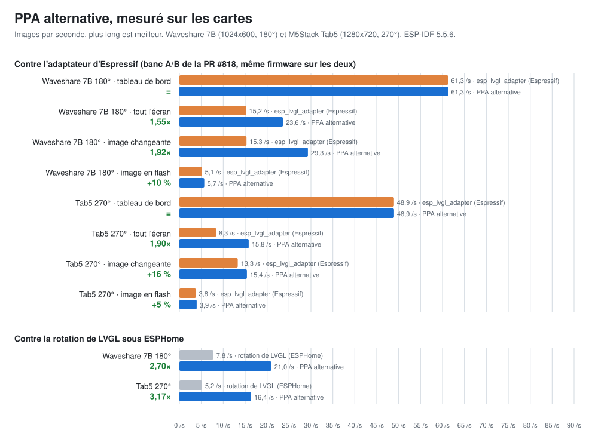
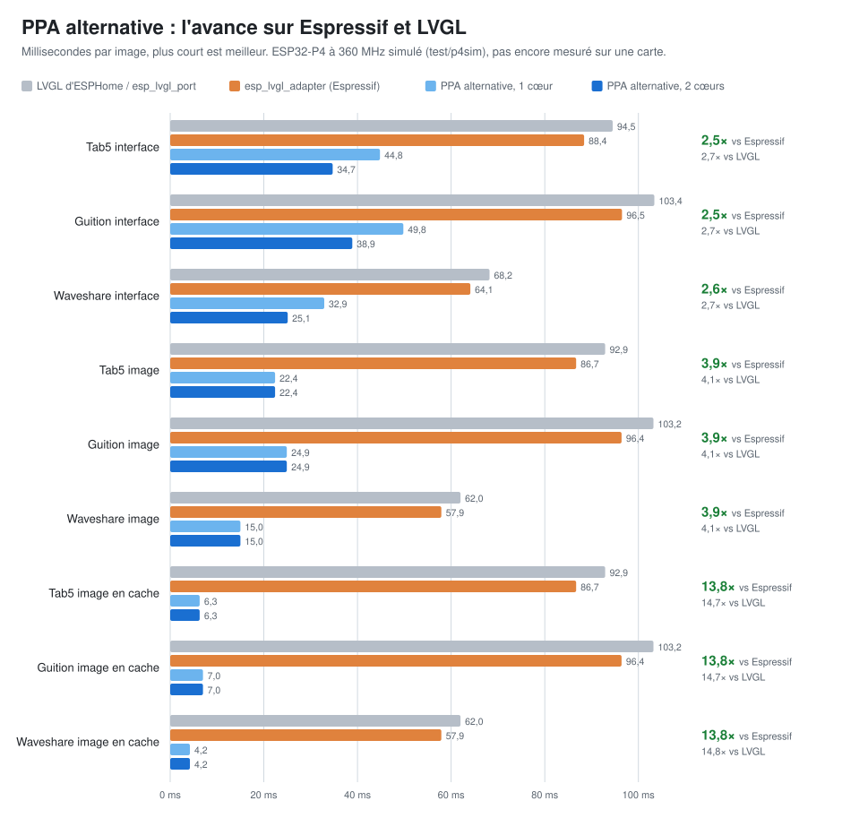

# ppa-alternative — `lv_draw_ortho`

**A turned LVGL screen on an ESP32-P4, drawn in the panel's own orientation:
LVGL draws, the PPA turns, and nothing is turned a second time.**

A panel used the other way round from how it was built — a Tab5 or a Guition
in landscape, a Waveshare upside down — costs LVGL two passes today: it draws
the screen upright, then turns the finished picture into the frame buffer.
LVGL 9 has the right idea already (`lv_display_set_matrix_rotation()` hands
each draw task a matrix), but its software renderer and its PPA unit ignore
that matrix. **`lv_draw_ortho` is a draw unit that reads it.**
`components/lvgl_ortho` puts it on an ESPHome board,
[`registry/lv_draw_ortho`](registry/lv_draw_ortho) is the same engine as an
ESP-IDF component, and
[esp-iot-solution PR #818](https://github.com/espressif/esp-iot-solution/pull/818)
put it in Espressif's own `esp_lvgl_adapter`.



## In short

Measured on two ESP32-P4 boards, the household's own:

| board | chip | panel | turned |
|---|---|---|---|
| Waveshare ESP32-P4-WIFI6-Touch-LCD-7B | rev 1.3 | EK79007 1024x600, 60.3 Hz | 180 (and 90) |
| M5Stack Tab5 | rev 1.0 | ILI9881C 720x1280, about 48 Hz | 270 (landscape) |

- **Against Espressif's adapter**, same benchmark firmware, same day: a
  whole screen redrawn (a page change, a scroll) **1.55x as fast on the
  Waveshare and 1.90x on the Tab5**; a full-screen picture changing every
  frame **1.92x and +16 %, for an eighth and a third of the CPU**; a small
  dashboard at the panel's own rate in both, for 0.4 to 0.8 ms more CPU a
  frame.
- **Against ESPHome's LVGL rotation**: a whole screen **2.7x as fast on the
  Waveshare and 3.2x on the Tab5**.
- **A camera on the whole screen**: 20.4 frames/s on the Tab5, against 10-12
  with LVGL's own rotation, and 27.8 on the Waveshare.

## Measured on the boards

### Inside Espressif's adapter: the A/B bench

PR #818 adds `CONFIG_ESP_LVGL_ADAPTER_ROTATE_IN_DRAW` to `esp_lvgl_adapter`:
`lv_draw_ortho`, the panel's frame buffers drawn in directly
(`DOUBLE_DIRECT`), and the engine keeping LVGL's frame buffers in step.
Espressif's adapter as it ships draws the screen upright in strips in internal
RAM and turns each strip with the PPA while the next is drawn
(`TRIPLE_PARTIAL`, its default on a MIPI DSI panel).

`espressif/pr818-ab/` builds **one benchmark firmware twice**: on the adapter
as Espressif ships it (`da53cfa`), and on the PR's branch with this
repository's engine (`test/rotate-in-draw-sync` on
[youkorr/esp-iot-solution](https://github.com/youkorr/esp-iot-solution)).
Same scenes, same code, same day: ESP-IDF v5.5.6, 360 MHz, PSRAM at 200 MHz,
ESP-IDF's default 128 KB of L2 cache, the flash in DIO at 40 MHz. Each scene
is 64 frames after 16 to warm up, run twice; the figure is the median. *CPU*
is the time the two cores were not idle (FreeRTOS's idle counters), both
added together, divided by the frames.

**Waveshare 7B**, 1024x600 turned 180:

| scene | Espressif's adapter | lv_draw_ortho |
|---|---|---|
| a dashboard: a few small areas a frame | 61.3 /s, 10.2 ms CPU | 61.3 /s, 10.6 ms CPU |
| the same dashboard redrawn whole | 15.2 /s, 95.4 ms CPU | **23.6 /s (1.55x)**, 68.7 ms CPU |
| a full-screen picture changing every frame | 15.3 /s, 72.4 ms CPU | **29.3 /s (1.92x)**, **9.1 ms CPU** |
| a full-screen picture in the flash | 5.1 /s, 298 ms CPU | **5.7 /s (+10 %)**, 282 ms CPU |
| the same picture drawn again (`image_cache`) | (no cache) | **29.7 /s**, 8.9 ms CPU |

**M5Stack Tab5**, 1280x720 turned 270:

| scene | Espressif's adapter | lv_draw_ortho |
|---|---|---|
| a dashboard: a few small areas a frame | 48.9 /s, 10.8 ms CPU | 48.9 /s, 11.6 ms CPU |
| the same dashboard redrawn whole | 8.3 /s, 183 ms CPU | **15.8 /s (1.90x)**, 103 ms CPU |
| a full-screen picture changing every frame | 13.3 /s, 80.4 ms CPU | **15.4 /s (+16 %)**, **27.1 ms CPU** |
| a full-screen picture in the flash | 3.76 /s, 408 ms CPU | **3.94 /s (+5 %)**, 401 ms CPU |
| the same picture drawn again (`image_cache`) | (no cache) | **15.4 /s**, 27.0 ms CPU |

What they say:

- **The dashboard is at the panel's rate in both columns**: one frame per
  scan-out (a median refresh of 15.6 and 19.9 ms here, 16.0 and 20.3 for the
  adapter). No adapter can show more frames than the panel does; what is left
  to compare is the CPU, 0.4 ms (Waveshare) and 0.8 ms (Tab5) a frame more
  here.
- **Wherever something big changes, more frames for less CPU.** A picture
  changing every frame on the Waveshare: twice the frames, the processor busy
  13 % of the time against 55 %. On the Tab5 the PPA's quarter turn sets the
  rate (below), and the CPU it costs falls from 80 to 27 ms a frame.
- **A picture in the flash** is mostly the flash being read, at 40 MHz in DIO
  on these boards, by either engine. Drawn again it comes out of the cache,
  in PSRAM, at the rate of a picture that changes.

The serial logs are in `test_pr818/` (`*-official-v12`, `*-native-v13`), and
`python3 test_pr818/depouiller.py` reads them again.
[`test_pr818/RESULTATS.md`](test_pr818/RESULTATS.md) (in French) goes through
every run since the first: the dashboard that started 38 % (Waveshare) and
40 % (Tab5) behind, and the faults found and fixed to close it -- LVGL's
copies between frame buffers made by the CPU, a picture in the flash handed
to the PPA, which reads flash more slowly than the CPU, and every tile inside
a card read back for nothing.

### Through ESPHome

`components/lvgl_ortho`, ESPHome 2026.12.0-dev with youkorr/lvgl_9.5, timed by `lvgl_bench` from `RENDER_START` to
`REFR_READY`. ESPHome's LVGL draws the screen upright, then turns it, one
after the other:

| | Tab5, 270 | Waveshare 7B, 180 |
|---|---|---|
| LVGL's own rotation | 193.6 ms | 129.0 ms |
| the same, the fork's PPA unit (`use_ppa`, `use_ppa_img`) | 176.1 ms | |
| lvgl_ortho, the CPU turning (`ppa: false`) | 177 ms | |
| lvgl_ortho, 1 core, frame copied to the panel | 78.5 ms | |
| lvgl_ortho, 2 cores, frame copied to the panel | 71.0 ms | |
| lvgl_ortho, 1 core, the panel's own frame buffers | | **57.0 ms** (2.3x) |
| lvgl_ortho, 2 cores, the panel's own frame buffers (`framebuffers: 3`) | **61.1 ms** (3.2x) | **47.7 ms** (2.7x) |

On the Tab5, the PPA turning 1280x720 is most of a frame: a quarter turn
runs at 15-18 Mpx/s on this chip (16x16 macro blocks below rev 3.0), which is
51-61 ms for the whole screen, and the drawing on both cores is hidden behind
it. Where in that range a frame lands depends on the tiles' size: through the
adapter with more internal RAM it was 54.4 ms (see the L2 cache below).
`pixel_mode: 16` and `24` measure the same, and narrower tiles were slower:
73.8 ms with tiles 256 pixels wide against 71.0, 82.2 at 128.
At 180 the turn is the PPA's easy case (about 41 Mpx/s), so on the Waveshare
what is left is drawing the UI; the second core gains 16 %.

### The cameras

Each board's own sensor, set up as its YAML in
[youkorr/esphome_esp-video](https://github.com/youkorr/esphome_esp-video)
does, through `esp_video_camera` and `lvgl_camera_display` from
[youkorr/esphome](https://github.com/youkorr/esphome) (branch
`esp_video_camera-lvgl`). The sensor's rate is the ceiling:

| board | panel, turn | sensor | format | the sensor sends |
|---|---|---|---|---|
| M5Stack Tab5 | 720x1280, 270 | SC2356 (SC202CS silicon) | RAW8 1280x720, 1 lane | 30 /s |
| Waveshare 7B | 1024x600, 180 | OV5647 | RAW10 1280x960 binned, its centre shown, 2 lanes | 45 /s |
| Guition 10" | 800x1280, 90 | OV02C10 | RAW10 1288x728, 1 lane | 30 /s |

The camera on the whole screen, each frame drawn by LVGL as a picture and
turned once by the PPA:

| | Tab5, SC2356 | Waveshare 7B, OV5647 |
|---|---|---|
| LVGL's own rotation | 10-12 /s | |
| lvgl_ortho, frame copied to the panel (ESPHome's `mipi_dsi`) | 12.8 /s | |
| lvgl_ortho, the panel's own frame buffers | 15.6 /s | 20.8 /s |
| the panel's own frame buffers, the main loop kept awake (`fast_loop: true`) | **20.4 /s** | **27.8 /s** |

- **The copy to the panel** is 14.4 ms a frame on the Tab5: the whole
  difference between the second and third rows. Drawing into the panel's own
  frame buffers removes it.
- **ESPHome's main loop sleeps** up to 16 ms between passes unless something
  wakes it, and `esp_video_camera` takes its frames from that loop, so a
  frame ready meanwhile waited. `fast_loop: true` on `lvgl_camera_display`
  holds the loop awake while the display is on: about 30 % more on both
  boards.
- **What is left is the PPA**, slowed by the camera's own memory traffic:
  31.7 ms of a 35.6 ms frame on the Waveshare is the CPU waiting for the PPA
  to turn 1024x600 (about 19 Mpx/s, half what a 180-degree turn of the whole
  screen does on its own), and 44.3 ms of 49 on the Tab5 for 1280x720. The
  OV5647 writes about 110 MB/s into the PSRAM the PPA reads and the panel
  scans out of.

**A camera picture is turned through internal RAM** (`camera_ram:`, 80 KB by
default). The PPA writing PSRAM costs it nothing over writing internal RAM,
but its reading PSRAM in 16x16 macro blocks doubles its time, and that read
is what the panel's scan-out and the camera slow down. So the picture's rows
are copied into internal RAM a band at a time by the AXI GDMA, while the PPA
turns the band before out of RAM. Measured with a probe firmware
(`espressif/ppa-probe`, on the branch `claude/esphome-pr-outdated-mdq36w`, not
merged yet), the camera streaming, a whole picture:

| | straight from PSRAM | bands of 16 rows | bands of 32 rows |
|---|---|---|---|
| Waveshare 7B, 1024x600 at 180 | 31.6 ms | 13.8 ms | 12.4 ms |
| Tab5, 1280x720 at 270 | 44.3 ms | 24.4 ms | 18.7 ms |

Without RAM of its own (`camera_ram: 0`, or no room at boot) the engine
lends its first tile instead: while a picture is turned whole no tile is
drawn, so its two halves are the bands, at no RAM cost. Both are checked on a
PC at every angle, pixel for pixel, with three planted mistakes caught; **not
yet run inside the engine on a board**. Anything the bands cannot take (no
room, a band shape the PPA cannot take whole because of DIG-734, a copy
refused) is the plain turn, said in the ten-second report.

The tests in `test/` put each board's sensor frame through the (fake) PPA
into its panel at its turn, and require the screen to match LVGL drawing the
same crop as an ordinary picture, pixel for pixel; 45 more cases cover
frames upright and already turned, smaller and bigger than the screen, cut
and mirrored, at every angle.

**ESP-IDF v5.5.6** did not start the camera of an ESP32-P4 below rev 3.0 at
all (`esp_cam_new_csi_ctlr: failed to configure format conversion`): it takes
the CSI bridge's input colour to be the ISP's output, and esp_video handed it
the sensor's RAW format, a conversion only rev 3.0 can do. esphome_esp-video
(commit 26e1be9) and Espressif's esp-video-components (79ae611) carry the
fix; no esp_video release does yet. Nothing in lvgl_ortho changes.

### Earlier: Espressif's own test app, and the L2 cache

Before the A/B bench, the PR was measured through the adapter's own test app
(`test_apps/lvgl9`, a dashboard redrawn whole for ten seconds), with the
engine as it stood before the November fixes and ESP-IDF v5.5.5. Every test
of the app passed in every run. The test app sets 256 KB of L2 cache, where
ESP-IDF's default is 128 KB, and that alone moved the PPA alternative a lot:

| | Espressif's adapter | PPA alternative, 256 KB of L2 | PPA alternative, 128 KB (ESP-IDF's default) |
|---|---|---|---|
| Waveshare 7B, 90 | 15.5 - 15.8 /s | 17.2 - 17.3 /s | **23.3 - 23.4 /s** (+50 %) |
| Waveshare 7B, 180 | 16.6 - 16.7 /s | 18.0 /s | **25.9 - 26.1 /s** (+56 %) |
| Tab5, 270 | 11.2 - 11.3 /s | 12.9 - 13.0 /s | **17.9 - 18.0 /s** (+61 %) |

Espressif's path does not move with the cache size. Every KB of L2 cache is a
KB less of internal RAM -- the heap's main internal block is 256 KiB with 256
KB of cache and 384 KiB with 128 KB -- and `lv_draw_ortho` draws its tiles in
internal RAM, cut out of whatever blocks fit there: with more of it the tiles
are bigger and there are fewer of them to turn. **Leave the L2 cache at
ESP-IDF's default.** The A/B bench above does.

Two things that test app showed and that still hold:

- **What the turn itself costs.** A build of the adapter run at rotation 0 by
  mistake drew the same screen in 47.0 - 47.5 ms. Over that, turning the
  Waveshare cost the adapter 16 ms at 90 and 12 ms at 180, and the PPA
  alternative 11 and 8: about a third less.
- **When a third frame buffer helps.** A first version of the PR drew into
  two and was *slower* at 90 (66.1 ms): a frame took 58.4 ms to draw, then
  waited for the panel to switch buffers on its next refresh, so on a 60 Hz
  panel every frame was rounded up to four refreshes. With three, LVGL draws
  the next frame into the third while the panel waits. A frame shorter than a
  refresh, like the A/B bench's dashboard on two buffers, does not pay this.
  The buffer LVGL draws into is then older than the last frame, and the engine
  brings it up to date (see
  [LVGL's copies between frame buffers](#lvgls-copies-between-frame-buffers)).

### Not measured yet

- **The Guition JC8012P4A1** (800x1280, 90) with `lv_draw_ortho`: only in the
  simulation and the PC tests, its OV02C10 camera only in the tests.
- **ESP32-P4 rev 3.0**, where the PPA's quarter turn works in 32x32 blocks
  rather than 16x16: neither board here has one. PR #818 carries a test that
  runs it on Espressif's CI board.
- **RGB panels**: the adapter path supports them and has never run on one.
- **A camera picture turned through internal RAM inside the engine**
  (`camera_ram:`, and the lent tile): the bands were measured with the probe
  firmware, not yet with the engine itself on a board.

## On an ESPHome board

Two lines change in a board's YAML: `rotation:` leaves the `lvgl:` block and
goes on `lvgl_ortho:`, with the same number.

```yaml
external_components:
  - source: github://youkorr/ppa-alternative-@main
    components: [lvgl_ortho]

lvgl:
  # no rotation: here any more
  buffer_size: 100%

lvgl_ortho:
  id: ortho
  rotation: 270           # what lvgl: had (ESPHome's degrees, clockwise)
  # ppa: true             # the default: the PPA turns while the CPU draws
  # cores: 2              # off by default: the second core draws every other tile
```

It takes LVGL's display over once ESPHome's lvgl has built it: one
panel-sized buffer in the panel's orientation, a flush that copies only the
rows that changed. Touches need nothing: LVGL turns a pointer by the
display's rotation itself.

- **The panel's own frame buffers.** With youkorr/lvgl_9.5's `mipi_dsi` and
  `framebuffers: 3`, LVGL draws straight into the buffer the panel will show
  and a finished frame is a pointer swap: nothing copied, nothing torn.
  Nothing to set; the boot log says which way it draws.
  `example/guition-lvgl-ortho-panel-buffers.yaml` is a whole board.
- **The camera.** `show_video(obj, frame, w, h)` turns a frame with one PPA
  pass into a window of the frame buffer LVGL keeps out of. In
  youkorr/esphome_esp-video's `lvgl_camera_display` that is one line,
  `ortho_id: ortho`. `example/guition-lvgl-ortho.yaml` is a whole board.
- **`ppa: false`** turns with the CPU instead, to compare.
- **Pictures that do not change** are turned once and kept in 4 MB of PSRAM
  (see [Pictures turned once](#pictures-turned-once)). Nothing to set;
  `image_cache: 0` turns it off, another size changes it.
- **`cores: 2`** draws every other tile on the second core (see
  [Two cores](#two-cores)). It needs LVGL built with an OS, which
  youkorr/lvgl_9.5 is, and is refused otherwise.
- **A big picture in PSRAM** -- a camera frame, a wallpaper -- is turned
  through 80 KB of internal RAM, in two bands. Nothing to set;
  `camera_ram:` changes the size: on a Tab5 160KB takes the turn from 24 to
  19 ms if internal RAM has room for it. The boot log says whether it was taken and how much
  internal RAM is left; the ten-second report how many pictures went through
  it. With `0`, or no room at boot, the bands are the two halves of the first
  tile, lent while the picture is turned: no tile is drawn then, so they cost
  no RAM at all, and with the default 128 KB tiles they are 64 KB each.

Every ten seconds the log says how much was turned, how much of it the PPA
did, how often the CPU waited for it, and how many tiles the second core drew,
then what the turned bytes were:

```
  turned 23040 KiB/s, 100% of it by the PPA, the CPU waited 38.4 times/s for it, 14.2 ms a screen
    of it: pictures 22800 KiB/s (1.00 a screen, 1200 KiB each), tiles out 120 KiB/s, read back under tiles 120 KiB/s
    pictures: 19.0/s, 0.0/s the same one again, 0.0/s into a layer; 19.2 refreshes/s drawn
```

A picture is a camera frame or a wallpaper drawn by LVGL. More than one a
screen, or more KiB each than the part of it on the glass (1200 KiB for a
1024x600 screen in RGB565), is the same frame drawn twice; read-back is what
lay under tiles of a part of the screen drawn again. The milliseconds a screen
are the PPA's share of each frame: the rest is LVGL, the camera and the loop. The last line says
where a second picture would come from: the same frame turned again, a
picture drawn into one of LVGL's layers and again as the layer, or refreshes
drawn and never shown (more refreshes than screens shown). (The figures above
are an example of the shape, not a measurement.)

## Testing it on the three boards

`yaml/test-lvgl.yaml` is one small firmware for all three boards: an
ordinary interface (text, cards with borders and shadows, a gradient, an arc,
a bar, a slider, a switch) and `lvgl_bench`. Two words at its top choose
everything:

```yaml
substitutions:
  board: tab5     # tab5, guition or waveshare
  mode: ortho     # ortho, ortho_2cores, ortho_cpu, or lvgl (ESPHome's own rotation)
```

| `board:` | board | screen | turn |
|---|---|---|---|
| `tab5` | M5Stack Tab5 | 720x1280 | 270 |
| `guition` | Guition JC8012P4A1 | 800x1280 | 90 |
| `waveshare` | Waveshare 7B | 1024x600 | 180 |

Flash one mode, press **LVGL bench** in Home Assistant, read **LVGL ms per
frame**; flash another and press again. The modes differ only in who turns
the screen, so the figure compares that and nothing else. It takes only
`lvgl` from `youkorr/lvgl_9.5`, keeps `buffer_size: 100%`, and needs
`wifi_ssid`, `wifi_password` and `api_encryption_key` in `secrets.yaml`.
CI compiles all twelve combinations with ESP-IDF. It includes `boards/` and
`modes/`, so copy the whole `yaml/` folder; for the Tab5,
`yaml/tab5-test-lvgl.yaml` is the same test in one file, the mode chosen in a
block at its top, and `yaml/waveshare-test-lvgl.yaml` the same again for the
Waveshare 7B turned over (180). It starts in the mode esp_lvgl_adapter's
ROTATE_IN_DRAW uses: one core, drawing into the panel's own frame buffers.
`yaml/waveshare-test-camera.yaml` is `yaml/tab5-test-camera.yaml` for that
board's OV5647.

`components/lvgl_bench` works the same way in any firmware: it times each
LVGL refresh from `RENDER_START` to `REFR_READY`, drawing, turn and flush
included, and reports it to Home Assistant:

```yaml
lvgl_bench:
  ms_per_frame:
    name: "LVGL ms per frame"
  max_fps:
    name: "LVGL max fps"

button:
  - platform: template
    name: "LVGL bench"
    on_press:
      - lvgl_bench.run: 10s
```

## Measuring it against Espressif's adapter

Two benches, both built by GitHub Actions for the Waveshare 7B and the Tab5,
each firmware a single `.bin` to write at `0x0`:

- **The A/B bench** (the figures at the top). `espressif/pr818-ab/prepare.py`
  turns the V9 benchmark (a dashboard, the same dashboard redrawn whole, a
  picture changing every frame, a picture in the flash with and without a
  cache) into a firmware for a board, built from any commit of
  esp-iot-solution: `--variant official` is the adapter as Espressif ships it,
  `--variant native` the PR's. `.github/workflows/pr818-ab.yml` builds all
  four (ESP-IDF v5.5.6). Open the serial log at 115200 baud, reset, and wait
  for `AB_DONE` (two to four minutes); `python3 test_pr818/depouiller.py`
  reads the logs, `--moteur` adds the engine's own `AB_NATIVE` lines (tiles
  read back, the second core's share).
- **The test app** (the earlier figures). `espressif/` turns
  esp-iot-solution's `test_apps/lvgl9`, from the branch of PR #818, into a
  firmware that runs by itself at boot: a timed whole-screen redraw, then
  every test of the app. `.github/workflows/espressif-test-app.yml` builds
  `rotate_in_draw` (the PR) and `copy` (the adapter as it is), with the
  ESP-IDF image (`v5.5.5` by default, `v6.1` measured too) and the L2 cache
  size (`256` or `128`) as inputs. The serial log says:

```
BENCH ROTATE_IN_DRAW (...): 173 frames in 10.0 s (17.3/s), 57.5 ms each, worst 59.2 ms
BENCH drawing alone (to the last flush): 57.5 ms each, ...
```

## How it works

**LVGL draws, the PPA turns.** Widgets are drawn in runs by LVGL's own
software renderer into an upright tile of 128 KiB in internal RAM, so the
pixels are LVGL's exactly and the drawing never touches PSRAM. The PPA turns
each tile into the frame buffer while the CPU draws the next one. When a
widget has to be blended over what is already on the screen, the PPA turns
that part of the frame buffer back into the tile first; a tile whose first
widget covers it (a background, a card) is never read back.

**Pictures and fills take a shorter way.** An opaque, unscaled picture is
turned by the PPA in one pass, from the image straight into the frame buffer.
A plain opaque rectangle is a PPA fill, its colour already narrowed to
RGB565 so the pixel is LVGL's whatever the PPA does when it narrows. A fill
that an opaque picture later in the same screen covers entirely is not drawn
at all. That is why a full-screen picture costs the PPA's turn and nothing
else.

**The camera** goes from its DMA buffer to the frame buffer in one PPA pass —
turned, mirrored, scaled or cropped — into a window every one of LVGL's writes
is cut around. Before each pass the window's rows are written back and
invalidated in the cache, so a line shared with LVGL's pixels cannot put old
video back. ESPHome and LVGL count quarter turns opposite ways (ESPHome's
`rotation: 90` is LVGL's `LV_DISPLAY_ROTATION_270`); the tests check the
turn against youkorr/lvgl_9.5's own rotation loops, which show a correct
picture on the Tab5.

### Pictures turned once

A picture that does not change is still turned every time it is drawn: a
wallpaper under a clock is turned whole once a second, a background under a
page that scrolls once a frame. With `image_cache:`, the second time an
opaque, unscaled picture of 32 KiB or more is drawn it is turned once into a
buffer of its own, and every draw after that is a straight copy out of it, by
the PPA at angle 0. A straight copy reads and writes rows in order, which is
what memory does fastest; a turn is the opposite.

Only pictures that cannot change are kept: those in the flash (an ESPHome
`image:`, anything compiled in), never a draw buffer LVGL marks modifiable (a
canvas, a camera frame). Each rotation is a copy of its own, the least
recently drawn go first when the budget is spent, and a picture bigger than
the budget is never kept. The log's ten-second line says how many pictures
came from the cache. Without ESPHome, `lv_draw_ortho_set_image_cache()`;
`lv_draw_ortho_set_image_constant_cb()` says which other pictures never
change, and `lv_draw_ortho_image_cache_drop()` forgets one changed in place.

It also takes the doubt out of the PPA's calibration for these pictures (see
[How it is measured](#how-it-is-measured)): a copy does not depend on how
fast the PPA turns, so a picture drawn again costs the same however slow the
Tab5's turn proves to be.

### Pictures in the flash

The PPA reads the flash more slowly than the CPU does. Measured through
Espressif's adapter, the same full-screen RGB565 picture drawn with nothing
kept: the PPA handed the flash took 224 ms a picture on a Waveshare 7B and
338 on a Tab5; the CPU read it into RAM in 171 and 239 (the flash there in
DIO at 40 MHz, about 7 MB/s). So the PPA is never handed a picture whose
pixels are in the flash: the CPU draws it into the tiles like any widget, on
both cores when there are two, and the PPA turns the tiles while the next are
drawn. With `image_cache:` the CPU reads such a picture once into the cache,
and the PPA copies the cache's copy, which is in PSRAM. The log's ten-second
line counts them ("big pictures/s in the flash drawn in the tiles"). Without
ESPHome, `lv_draw_ortho_set_flash_cb()` says which pictures those are where
the address alone does not.

### LVGL's copies between frame buffers

With two or three frame buffers in DIRECT mode (youkorr/lvgl_9.5's mipi_dsi
with `framebuffers:`, or Espressif's adapter in DOUBLE_DIRECT), LVGL keeps
them in step: at the start of every refresh it copies into the buffer it is
about to draw what the last frame drew, less what this one will draw — by the
CPU, PSRAM into PSRAM, and before it knows whether there is anything to draw
at all. A refresh with nothing to draw (LVGL's own timer, between two
pictures) still copies everything the last frame drew, and the next frame
draws over it. Through Espressif's adapter that was 13.2 ms a frame on a
Waveshare 7B and 20.7 on a Tab5, with a picture changing every frame.

LVGL makes each of those copies through the destination buffer's own
`buf_copy_cb`, so lv_draw_ortho takes them over there, without changing
LVGL: each copy is written down, and when a buffer is about to be drawn into
(`LV_EVENT_RENDER_START`), only what it is behind by and the frame does not
draw is copied, from the buffer shown last, by the PPA. LVGL's copies are
told apart exactly, by their area being one of LVGL's own list; any other
copy between the same buffers (the adapter's, for its third buffer) is made at
once, by the PPA. Buffers set again later (a dummy draw, a new panel) are
taken again at the next frame. `lvgl_ortho` does this by itself on the
panel's buffers; elsewhere, `lv_draw_ortho_take_sync()`. The ten-second line
says how much LVGL would have copied and how much was ("buffers kept in
step").

### Cards: a tile under a background is not read back

A tile starts as what is already on the glass under it -- turned back out of
the frame buffer, by the PPA, while the CPU waits -- unless the first thing
drawn there paints all of it. In a card, the first thing drawn is its shadow,
which its background then covers. That was recognised only where the
background is the shadow's own rectangle, and a card with a border has its
background drawn a pixel inside (LVGL leaves the border's anti-aliasing room).
So every tile inside such a card was read back first, and the shadow painted
under the background for nothing: on the dashboard of `test_pr818/` at a
Waveshare 7B's size, **82,000 pixels turned a frame for 48,800 drawn**, and
the board's own log said the same (151 KiB turned a frame). What a rounded
background certainly covers is now its cross, the rectangle less its four
corners, and the same for the inside of a rounded border: no tile of that
dashboard is read back, 48,800 pixels are turned, and 35% fewer are painted.

### Two cores

With the PPA turning, what is left of a redraw is LVGL drawing, on one core
while the other idles. `cores: 2` hands the second core every other tile.
**Only the drawing moves**: the second core runs LVGL's renderer into a tile
of its own and nothing else, while reading the frame buffer, turning and
every PPA transfer stay on the core LVGL runs on.

Two renderers at once is what LVGL itself does with
`LV_DRAW_SW_DRAW_UNIT_CNT > 1`, and it is safe for the same reason: the state
they share (the circle cache of rounded corners, the image decoders) is
behind LVGL's mutexes — which are real only with an OS. With `LV_OS_NONE`
`cores: 2` is refused. **A font is not behind those mutexes**, and ESPHome's
is not safe on two cores: `esphome::font::Font` keeps the last glyph it
looked up in two plain members, so a lookup on one core can hand the other
the wrong glyph, written into a buffer sized for another. On a Tab5 that was
a crash a few minutes into a screen with a large clock under moving lights.
So each text draw is under a mutex, from the font being asked for a glyph to
its bitmap being drawn, and everything else in both tiles is still drawn at
once; a test font that counts the cores inside it at once holds this to one.
(The first guard drew a whole pair of tiles one after the other when both
held text. Through Espressif's adapter, the commit carrying it measured a
dashboard 12% slower on a Waveshare 7B and 18% on a Tab5, and the guard was
taken for the cause there, not measured apart; the mutex round each text draw
is the fix made there, brought back here.) Tiles go in pairs, four of them with a PPA so a pair is
drawn while the last pair is turned; where internal RAM has no room for two
more, the two there are cut in half (no extra RAM, about a quarter more
drawing, still faster):

| ms, panel buffers, simulated | one core | two cores, halved tiles | two cores, four whole tiles (+256 KiB) |
|---|---|---|---|
| Tab5 interface | 44.8 | **34.7** | 31.8 |
| Guition interface | 49.8 | **38.9** | 33.9 |
| Waveshare interface | 32.9 | **25.1** | 23.7 |

Those are simulated. Measured, the second core gains 10 % on the Tab5 at 270
(78.5 to 71.0 ms, frame copied to the panel), where the PPA's turn is the
limit, and 16 % on the Waveshare at 180 (57.0 to 47.7 ms), where drawing is.
It costs the second core's time and a 12 KiB stack, so it is off by default:
compare `ortho` and `ortho_2cores` with `lvgl_bench` and keep the faster.

**The second core's tile goes to the other core than the drawing task**,
whichever that is: there is a task pinned to each core, the second started
the first time it is needed (a second stack). LVGL's task has no core of its
own, and an application may refresh from a task pinned anywhere; a single
task pinned once, opposite the core LVGL happened to be on, could be on the
very core that hands it the tile, and both halves were then painted one after
the other. `helper_cores` in the stats says which cores have one.


**A pair is two tiles of one redraw**, and a redraw that fits in one tile is
cut in two for it. It was not until November 2026: a redraw of one tile was
all the first core's, and so a dashboard -- a few small areas a frame, a card,
a bar, a slider -- ran on one core. On the same scene on a PC the second core
painted 1 tile of 120; it paints 74 of 193 now, a tile under
`LV_DRAW_ORTHO_PAIR_MIN_PX` (8192 pixels) being left whole. On the boards it
first gave nothing (38.6 to 38.4 frames/s on the Waveshare, 29.4 to 30.0 on
the Tab5): every tile inside a card was read back by the PPA first, and both
cores waited for that. With the cards fixed the dashboard is at the panel's
rate on both boards, and the A/B bench's `AB_NATIVE` line reads 2.3 tiles a
frame on the second core. On a whole screen redrawn it gets half of them:
the boards' logs during `lvgl_bench` read `960 of 1920 tiles painted on the
second core` (Tab5) and the like. Over a camera it gets **none**, and that is
expected rather than a fault: the frame is a picture, turned in one PPA pass
without tiles, and what is
left each frame is a tile or two -- the scroll bars a canvas bigger than the
screen draws over it, a label -- each a redraw of its own. A night of the
OV5647 on the Waveshare read `0 of 345 tiles`, about 1.8 tiles a screen. The
PC tests draw a canvas bigger than its screen and find the same: a few KiB of
tiles a frame, which go when the screen's scroll bars are turned off
(`scrollbar_mode: "OFF"` on the canvas's parent, which also takes the bars
off the picture).


### The PPA's faults, and what is done about them

Read in ESP-IDF's, LVGL's and ESPHome's own issues and pull requests (October
2026):

| | what it is | elsewhere | here |
|---|---|---|---|
| **DIG-734** ([esp-idf #19023](https://github.com/espressif/esp-idf/issues/19023), [#19096](https://github.com/espressif/esp-idf/issues/19096), [#18768](https://github.com/espressif/esp-idf/pull/18768)) | at 90 and 270, a block whose last macro block leaves the DMA under its FIFO depth never finishes | fixed on ESP-IDF master (469aa16), **not in v5.5.6**, which ESPHome 2026.10 builds with; esp_lvgl_adapter's "PPA freeze with rotation" is this | `lv_draw_ortho_ppa.c` applies the driver's test both ways and cuts a block into pieces that are either given the bypass or leave at least twice the FIFO's depth in their last macro block (below), each at least 16 pixels a side: no sliver. Every size up to 1300x1300, at 90 and 180, 16 and 24 bits, checked: at most 7 pieces, 0.7% of sizes (0.03% of their pixels) left to the CPU |
| **an unbounded wait** | the driver's blocking mode waits for ever: a stuck transfer is a frozen screen | LVGL's PPA unit blocks with no timeout; the author's own [lvgl #10265](https://github.com/lvgl/lvgl/pull/10265) (open, not merged) keeps that call | every wait is bounded (`LV_DRAW_ORTHO_PPA_TIMEOUT_MS`, 250 ms) and sleeps on the PPA's own interrupt rather than polling, so the core is free while it waits; past it the CPU turns, the video window is refused, and the screen is redrawn and the log says so, with the transaction that never finished: its whole geometry, the buffers, and the bypass each driver would program |
| **DMA2D reset hang** ([esp-idf #18999](https://github.com/espressif/esp-idf/issues/18999), [#19108](https://github.com/espressif/esp-idf/issues/19108)) | after a software reset a DMA2D channel can wait for ever inside a spinlock | open at Espressif | **not handled**: it spins below anything a component can bound. A power cycle clears it |
| **DIG-734 at the FIFO's exact depth** (Tab5, `yaml/tab5-camera-ui.yaml`, November 2026) | a block whose last macro block leaves exactly 1536 bits -- 464x70 turned 90, a tile band behind three moving lights -- never finished, right after an identical one had: most likely a race at the exact depth | **not known elsewhere**: both drivers, v5.5 and master, bypass only strictly below the depth | found from the board's own report of the transaction that never finished (`lv_draw_ortho_ppa_describe_stall()`). A block sent without the bypass now leaves at least twice the depth, a whole FIFO of margin; a bypass given where it is not needed does no harm, since Espressif's own esp_lvgl_adapter patches ESP-IDF to give it to every transaction ("Temporary fix for the PPA hang issue"). The test PPA now hangs on the exact depth, and an existing test scene was already sending one |

## How it is measured

**On a PC, pixel for pixel.** `test/` builds LVGL 9.5.0, 9.6.0 and `master`
and draws the same screens two ways, upright then turned, and through
`lv_draw_ortho`: 90, 180 and 270, RGB565 and XRGB8888, odd sizes, direct and
partial render modes, pictures, the camera at the three boards' real sizes,
and the ESPHome component itself. The PPA is a fake one (`test/p4stub/`) that
turns as the boards' does, reproduces DIG-734 as the v5.5.6 driver meets it,
and holds every transfer until it is waited for, so a missing wait leaves a
wrong picture. The second core runs on real threads, under ThreadSanitizer.
Mistakes are planted on purpose (`ppa_mutants.py`, `esphome_mutants.py`) and
every one must make a test fail.

One pixel, in three cases, is excused, and only because LVGL draws it the
same way: LVGL's line renderer loses an anti-aliased pixel when a band ends
on a polyline's joint, and `build/ortho_test --lvgl-quirk` shows LVGL alone
doing it.

**On a simulated ESP32-P4, before the boards.** `test/p4sim/p4sim.py` builds the
same bench for the P4's RISC-V core, runs it in QEMU under a plugin that
counts every instruction and runs every load and store through the P4's
caches (64 KiB L1, 128 KiB L2 in front of PSRAM), and replays each redraw's
timeline: when a transfer is handed to the PPA, when the CPU needs one
finished, when the two cores meet. Instructions become milliseconds with
figures measured on the household's boards: a PSRAM copy on the Tab5 (32 to
35 ms for 1280x620) and the PPA's turn on a Waveshare 7B (14.9 ms for
1024x600). Assumed, not measured: cycles per instruction outside a cache
miss, the cost of a line from the L2, a fill at half a turn's cost, and
whether the P4's two cores share their L1 cache.

What it gave, in milliseconds per frame at 360 MHz, middle assumptions, LVGL
drawing into the panel's own frame buffers:



| | ESPHome lvgl / esp_lvgl_port | esp_lvgl_adapter (Espressif) | PPA alternative, 1 core | PPA alternative, 2 cores |
|---|---|---|---|---|
| Tab5 interface (270) | 94.5 | 88.4 | 44.8 | **34.7** |
| Guition interface (90) | 103.4 | 96.5 | 49.8 | **38.9** |
| Waveshare interface (180) | 68.2 | 64.1 | 32.9 | **25.1** |
| Tab5 full-screen picture | 92.9 | 86.7 | **22.4** | 22.4 |
| Guition full-screen picture | 103.2 | 96.4 | **24.9** | 24.9 |
| Waveshare full-screen picture | 62.0 | 57.9 | **15.0** | 15.0 |
| Tab5 same picture drawn again (`image_cache`) | 92.9 | 86.7 | **6.3** | 6.3 |
| Guition same picture drawn again | 103.2 | 96.4 | **7.0** | 7.0 |
| Waveshare same picture drawn again | 62.0 | 57.9 | **4.2** | 4.2 |
| Tab5 camera through `ortho_id` | 92.9 | 86.7 | **22.3** | 22.3 |

`docs/chart.py` draws that chart from `docs/p4sim-resultats.csv`;
`docs/chart_boards.py` draws the one at the top from
`docs/mesures-cartes.csv`.

**The boards say the simulation was right about Espressif's path and far too
kind to ours.** For the adapter it gave 88.4 ms on the Tab5 and 64.1 on the
Waveshare at 180; the test app measured 81.5 and 59.5. For the PPA
alternative it gave 34.7 and 25.1, and the boards measured 61.1 and 47.7
under ESPHome (54.4 on the Tab5 through the test app with ESP-IDF's default
L2 cache). Two reasons, one measured and one not:

- **The PPA's quarter turn.** The simulation's PPA rate comes from a single
  turn of 180 on a Waveshare 7B, 14.9 ms for 1024x600, applied flat: 41.3
  Mpx/s whatever the angle. A quarter turn on these chips is 15-18 Mpx/s,
  measured on the Tab5 one image at a time (0.92 ms for 128x128 against 0.40
  predicted, 4.33 against 1.59 for 256x256, 15.35 against 6.34 for 512x512)
  and confirmed by the whole screen: 54.4 - 61.1 ms is the PPA turning
  1280x720 at that rate.
- **The drawing.** At 180 the PPA's rate was right, and the Waveshare still
  measured twice the simulation: drawing the UI on two cores costs more on
  the board than the model of one memory access at a time allowed. Most
  likely the PSRAM, which both cores, the PPA and the panel's scanout share.
  Not measured apart.

So the simulation is kept for what it did -- choosing the design, and
counting where the time goes -- and the boards' figures are the ones to
quote.

## Running the tests

```
git clone --depth 1 -b v9.5.0 https://github.com/lvgl/lvgl /tmp/lvgl
cd test
make LVGL=/tmp/lvgl run            # 563 cases, and the ESPHome component at four angles
build/ortho_test --ppa             # the PPA's cases alone
build/ortho_test --lvgl-quirk      # LVGL alone, drawn whole and in bands
python3 ppa_mutants.py             # each wait for the PPA taken out must fail a case
python3 ppa_mutants.py --only copies   # ...or only those whose name holds a word
python3 esphome_mutants.py         # each break in the ESPHome component must fail a case

# the second core: LVGL built with pthreads
make LVGL=/tmp/lvgl BUILD=build-mt CFLAGS="-O2 -g -DLV_USE_OS=1" build-mt/ortho_test
build-mt/ortho_test --cores        # every case, every other tile on another thread
python3 ppa_mutants.py --cores     # each mistake planted in the two-core path must fail

# the simulated P4 (needs a RISC-V gcc, picolibc and qemu-system-riscv32)
python3 p4sim/p4sim.py --lvgl /tmp/lvgl
```

The LVGL tree is copied and the patch for its version applied inside
`test/build`, so the tree given is never modified. In ThreadSanitizer runs,
`test/tsan.supp` sets aside one race that is LVGL's own (9.6 and `master`
read a circle-cache field outside its mutex) and says why it is harmless.

## Without ESPHome

In an ESP-IDF project the engine is a component of its own,
[`registry/lv_draw_ortho`](registry/lv_draw_ortho), packed for the ESP
Component Registry with a complete example for the Waveshare 7B:

```c
#include "lv_draw_ortho.h"
#include "lv_draw_ortho_ppa.h"

lv_init();
lv_draw_ortho_init();                       /* after lv_init() */
lv_draw_ortho_ppa_init();                   /* ESP32-P4: the PPA turns and fills */
lv_draw_ortho_set_cores(2);                 /* optional, needs LV_USE_OS */
lv_draw_ortho_set_image_cache(4 << 20);     /* optional: pictures that do not change turned once */

lv_display_t * d = lv_display_create(720, 1280);   /* the PANEL's size */
lv_display_set_buffers(d, buf, NULL, size, LV_DISPLAY_RENDER_MODE_DIRECT);
lv_display_set_rotation(d, LV_DISPLAY_ROTATION_270);
lv_display_set_matrix_rotation(d, true);
/* flush_cb: the buffer is already in the panel's orientation -- copy it, never turn it. */
```

`lv_conf.h` needs `LV_USE_FLOAT 1`, `LV_USE_MATRIX 1` and
`LV_DRAW_TRANSFORM_USE_MATRIX 1`. **Partial render mode** needs the patch for
your LVGL in `patches/`: neither 9.5 nor 9.6 allows matrix rotation outside
direct and full modes. A picture already stored in the panel's orientation is
copied with no turn at all: set `LV_DRAW_ORTHO_IMAGE_FLAG_NATIVE` in its
`header.flags` and give the native row length in `header.stride`.
`lv_draw_ortho_get_stats()` says which path each frame took. An object with a
free rotation angle is not a quarter turn, so it is counted in
`tasks_refused` rather than drawn wrongly.

## Going upstream

For Espressif, [esp-iot-solution PR #818](https://github.com/espressif/esp-iot-solution/pull/818)
brought `lv_draw_ortho` into `esp_lvgl_adapter` as
`CONFIG_ESP_LVGL_ADAPTER_ROTATE_IN_DRAW`. Espressif measured it on their own
boards (refreshes a second from about 29.5 to 60.9 and from 25.0 to 38.8, the
CPU from 39 % to 2 %) and decided not to merge it into the general-purpose
adapter, for its internal RAM, its reliance on LVGL's internals and its
maintenance; they keep it as a reference for the adapter's v1.0. The
component in `registry/lv_draw_ortho` is the optional backend instead. Nothing here is specific to
Espressif except `lv_draw_ortho_ppa.c`: any MCU driving a panel on its side
has the same problem. For LVGL, three separate
things: the draw unit as the software renderer's answer to matrix rotation;
the partial-mode patch (`patches/lvgl-10.0.0-*.patch` for `master`); and the
line renderer losing a pixel at a band cut, as a bug report with
`--lvgl-quirk` as the reproduction. Beside the author's own lvgl/lvgl#10265
(the PPA unit's scaled and rotated images), this is complementary: that PR
turns an image, this one stops turning the screen. For ESPHome, the unit lives
in an external component first, where it can be flashed and measured.

## History

How this got here — the PC measurements, the first simulated run that showed
the CPU turn losing to Espressif, and each step since — is in
[`docs/HISTORY.md`](docs/HISTORY.md), the README as it stood before this
rewrite.

## Licence

MIT, like LVGL.
