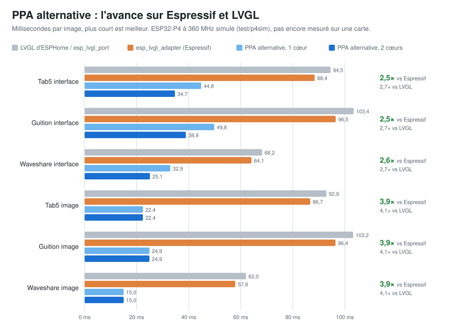

# ppa-alternative — `lv_draw_ortho`

**A turned LVGL screen on an ESP32-P4, drawn in the panel's own orientation:
LVGL draws, the PPA turns, and nothing is turned a second time.**

A panel used the other way round from how it was built — a Tab5 or a Guition
in landscape, a Waveshare upside down — costs LVGL two passes today: it draws
the screen upright, then turns the finished picture into the frame buffer.
LVGL 9 has the right idea already (`lv_display_set_matrix_rotation()` hands
each draw task a matrix), but its software renderer and its PPA unit ignore
that matrix. **`lv_draw_ortho` is a draw unit that reads it**, and
`components/lvgl_ortho` puts it on an ESPHome board.



**Not yet run on a board.** Every figure here comes from a simulated
ESP32-P4 (see [How it is measured](#how-it-is-measured)); every picture is
checked pixel for pixel against LVGL on a PC.

## Results

Milliseconds per frame on a simulated ESP32-P4 at 360 MHz, middle assumptions,
LVGL drawing into the panel's own frame buffers:

| | ESPHome lvgl / esp_lvgl_port | esp_lvgl_adapter (Espressif) | PPA alternative, 1 core | PPA alternative, 2 cores |
|---|---|---|---|---|
| Tab5 interface (270) | 94.5 | 88.4 | 44.8 | **34.7** (2.5x) |
| Guition interface (90) | 103.4 | 96.5 | 49.8 | **38.9** (2.5x) |
| Waveshare interface (180) | 68.2 | 64.1 | 32.9 | **25.1** (2.6x) |
| Tab5 full-screen picture | 92.9 | 86.7 | **22.4** (3.9x) | 22.4 |
| Guition full-screen picture | 103.2 | 96.4 | **24.9** (3.9x) | 24.9 |
| Waveshare full-screen picture | 62.0 | 57.9 | **15.0** (3.9x) | 15.0 |
| Tab5 camera through `ortho_id` | 92.9 | 86.7 | **22.3** | 22.3 |

(x: how many times faster than esp_lvgl_adapter.) With ESPHome's own
`mipi_dsi` instead of the panel's frame buffers, add the display's copy:
6.2 ms on the Tab5. `docs/chart.py` draws the chart above from
`docs/p4sim-resultats.csv`.

## On an ESPHome board

Two lines change in a board's YAML: `rotation:` leaves the `lvgl:` block and
goes on `lvgl_ortho:`, with the same number.

```yaml
external_components:
  - source: github://youkorr/ppa-alternative-@main
    components: [lvgl_ortho]

lvgl:
  # no rotation: here any more
  buffer_size: 100%

lvgl_ortho:
  id: ortho
  rotation: 270           # what lvgl: had (ESPHome's degrees, clockwise)
  # ppa: true             # the default: the PPA turns while the CPU draws
  # cores: 2              # off by default: the second core draws every other tile
```

It takes LVGL's display over once ESPHome's lvgl has built it: one
panel-sized buffer in the panel's orientation, a flush that copies only the
rows that changed, and touches turned back to the screen's coordinates.

- **The panel's own frame buffers.** With youkorr/lvgl_9.5's `mipi_dsi` and
  `framebuffers: 3`, LVGL draws straight into the buffer the panel will show
  and a finished frame is a pointer swap: nothing copied, nothing torn.
  Nothing to set; the boot log says which way it draws.
  `example/guition-lvgl-ortho-panel-buffers.yaml` is a whole board.
- **The camera.** `show_video(obj, frame, w, h)` turns a frame with one PPA
  pass into a window of the frame buffer LVGL keeps out of. In
  youkorr/esphome_esp-video's `lvgl_camera_display` that is one line,
  `ortho_id: ortho`. `example/guition-lvgl-ortho.yaml` is a whole board.
- **`ppa: false`** turns with the CPU instead, to compare.
- **`cores: 2`** draws every other tile on the second core (see
  [Two cores](#two-cores)). It needs LVGL built with an OS, which
  youkorr/lvgl_9.5 is, and is refused otherwise.

Every ten seconds the log says how much was turned, how much of it the PPA
did, how often the CPU waited for it, and how many tiles the second core drew.

## Testing it on the three boards

`yaml/test-lvgl.yaml` is one small firmware for all three boards: an
ordinary interface (text, cards with borders and shadows, a gradient, an arc,
a bar, a slider, a switch) and `lvgl_bench`. Two words at its top choose
everything:

```yaml
substitutions:
  board: tab5     # tab5, guition or waveshare
  mode: ortho     # ortho, ortho_2cores, ortho_cpu, or lvgl (ESPHome's own rotation)
```

| `board:` | board | screen | turn |
|---|---|---|---|
| `tab5` | M5Stack Tab5 | 720x1280 | 270 |
| `guition` | Guition JC8012P4A1 | 800x1280 | 90 |
| `waveshare` | Waveshare 7B | 1024x600 | 180 |

Flash one mode, press **LVGL bench** in Home Assistant, read **LVGL ms per
frame**; flash another and press again. The modes differ only in who turns
the screen, so the figure compares that and nothing else. It takes only
`lvgl` from `youkorr/lvgl_9.5`, keeps `buffer_size: 100%`, and needs
`wifi_ssid`, `wifi_password` and `api_encryption_key` in `secrets.yaml`.
CI compiles all twelve combinations with ESP-IDF.

`components/lvgl_bench` works the same way in any firmware: it times each
LVGL refresh from `RENDER_START` to `REFR_READY`, drawing, turn and flush
included, and reports it to Home Assistant:

```yaml
lvgl_bench:
  ms_per_frame:
    name: "LVGL ms per frame"
  max_fps:
    name: "LVGL max fps"

button:
  - platform: template
    name: "LVGL bench"
    on_press:
      - lvgl_bench.run: 10s
```

## How it works

**LVGL draws, the PPA turns.** Widgets are drawn in runs by LVGL's own
software renderer into an upright tile of 128 KiB in internal RAM, so the
pixels are LVGL's exactly and the drawing never touches PSRAM. The PPA turns
each tile into the frame buffer while the CPU draws the next one. When a
widget has to be blended over what is already on the screen, the PPA turns
that part of the frame buffer back into the tile first; a tile whose first
widget covers it (a background, a card) is never read back.

**Pictures and fills take a shorter way.** An opaque, unscaled picture is
turned by the PPA in one pass, from the image straight into the frame buffer.
A plain opaque rectangle is a PPA fill, its colour already narrowed to
RGB565 so the pixel is LVGL's whatever the PPA does when it narrows. A fill
that an opaque picture later in the same screen covers entirely is not drawn
at all. That is why a full-screen picture costs the PPA's turn and nothing
else.

**The camera** goes from its DMA buffer to the frame buffer in one PPA pass —
turned, mirrored, scaled or cropped — into a window every one of LVGL's writes
is cut around. Before each pass the window's rows are written back and
invalidated in the cache, so a line shared with LVGL's pixels cannot put old
video back. ESPHome and LVGL count quarter turns opposite ways (ESPHome's
`rotation: 90` is LVGL's `LV_DISPLAY_ROTATION_270`); the tests check the
turn against youkorr/lvgl_9.5's own rotation loops, which show a correct
picture on the Tab5.

### Two cores

With the PPA turning, what is left of a redraw is LVGL drawing, on one core
while the other idles. `cores: 2` hands the second core every other tile.
**Only the drawing moves**: the second core runs LVGL's renderer into a tile
of its own and nothing else, while reading the frame buffer, turning and
every PPA transfer stay on the core LVGL runs on.

Two renderers at once is what LVGL itself does with
`LV_DRAW_SW_DRAW_UNIT_CNT > 1`, and it is safe for the same reason: the state
they share (the circle cache of rounded corners, the image decoders) is
behind LVGL's mutexes — which are real only with an OS. With `LV_OS_NONE`
`cores: 2` is refused. Tiles go in pairs, four of them with a PPA so a pair is
drawn while the last pair is turned; where internal RAM has no room for two
more, the two there are cut in half (no extra RAM, about a quarter more
drawing, still faster):

| ms, panel buffers | one core | two cores, halved tiles | two cores, four whole tiles (+256 KiB) |
|---|---|---|---|
| Tab5 interface | 44.8 | **34.7** | 31.8 |
| Guition interface | 49.8 | **38.9** | 33.9 |
| Waveshare interface | 32.9 | **25.1** | 23.7 |

It costs the second core's time and a 12 KiB stack, so it is off by default:
compare `ortho` and `ortho_2cores` with `lvgl_bench` and keep the faster.

### The PPA's faults, and what is done about them

Read in ESP-IDF's, LVGL's and ESPHome's own issues and pull requests (October
2026):

| | what it is | elsewhere | here |
|---|---|---|---|
| **DIG-734** ([esp-idf #19023](https://github.com/espressif/esp-idf/issues/19023), [#19096](https://github.com/espressif/esp-idf/issues/19096), [#18768](https://github.com/espressif/esp-idf/pull/18768)) | at 90 and 270, a block whose last macro block leaves the DMA under its FIFO depth never finishes | fixed on ESP-IDF master (469aa16), **not in v5.5.6**, which ESPHome 2026.10 builds with; esp_lvgl_adapter's "PPA freeze with rotation" is this | `lv_draw_ortho_ppa_dig734()` applies the driver's test both ways and cuts a block that would hang into safe pieces (every size up to 1300x1300 checked) |
| **an unbounded wait** | the driver's blocking mode waits for ever: a stuck transfer is a frozen screen | LVGL's PPA unit blocks with no timeout; the author's own [lvgl #10265](https://github.com/lvgl/lvgl/pull/10265) (open, not merged) keeps that call | every wait is bounded (`LV_DRAW_ORTHO_PPA_TIMEOUT_MS`, 250 ms); past it the CPU turns, the video window is refused, and the screen is redrawn and the log says so |
| **DMA2D reset hang** ([esp-idf #18999](https://github.com/espressif/esp-idf/issues/18999), [#19108](https://github.com/espressif/esp-idf/issues/19108)) | after a software reset a DMA2D channel can wait for ever inside a spinlock | open at Espressif | **not handled**: it spins below anything a component can bound. A power cycle clears it |

## How it is measured

**On a PC, pixel for pixel.** `test/` builds LVGL 9.5.0, 9.6.0 and `master`
and draws the same screens two ways, upright then turned, and through
`lv_draw_ortho`: 90, 180 and 270, RGB565 and XRGB8888, odd sizes, direct and
partial render modes, pictures, the camera at the three boards' real sizes,
and the ESPHome component itself. The PPA is a fake one (`test/p4stub/`) that
turns as the boards' does, reproduces DIG-734 as the v5.5.6 driver meets it,
and holds every transfer until it is waited for, so a missing wait leaves a
wrong picture. The second core runs on real threads, under ThreadSanitizer.
Mistakes are planted on purpose (`ppa_mutants.py`, `esphome_mutants.py`) and
every one must make a test fail.

One pixel, in three cases, is excused, and only because LVGL draws it the
same way: LVGL's line renderer loses an anti-aliased pixel when a band ends
on a polyline's joint, and `build/ortho_test --lvgl-quirk` shows LVGL alone
doing it.

**On a simulated ESP32-P4, for the timings.** `test/p4sim/p4sim.py` builds the
same bench for the P4's RISC-V core, runs it in QEMU under a plugin that
counts every instruction and runs every load and store through the P4's
caches (64 KiB L1, 128 KiB L2 in front of PSRAM), and replays each redraw's
timeline: when a transfer is handed to the PPA, when the CPU needs one
finished, when the two cores meet. Instructions become milliseconds with
figures measured on the household's boards: a PSRAM copy on the Tab5 (32 to
35 ms for 1280x620) and the PPA's turn on a Waveshare 7B (14.9 ms for
1024x600). Assumed, not measured: cycles per instruction outside a cache
miss, the cost of a line from the L2, a fill at half a turn's cost, and
whether the P4's two cores share their L1 cache.

**On the board, still to do.** The `lvgl_ortho` lines in the log and
`lvgl_bench`'s figure are what will say whether the simulation was right.

## Running the tests

```
git clone --depth 1 -b v9.5.0 https://github.com/lvgl/lvgl /tmp/lvgl
cd test
make LVGL=/tmp/lvgl run            # 202 cases, and the ESPHome component at four angles
build/ortho_test --ppa             # the PPA's cases alone
build/ortho_test --lvgl-quirk      # LVGL alone, drawn whole and in bands
python3 ppa_mutants.py             # each wait for the PPA taken out must fail a case
python3 esphome_mutants.py         # each break in the ESPHome component must fail a case

# the second core: LVGL built with pthreads
make LVGL=/tmp/lvgl BUILD=build-mt CFLAGS="-O2 -g -DLV_USE_OS=1" build-mt/ortho_test
build-mt/ortho_test --cores        # every case, every other tile on another thread
python3 ppa_mutants.py --cores     # each mistake planted in the two-core path must fail

# the simulated P4 (needs a RISC-V gcc, picolibc and qemu-system-riscv32)
python3 p4sim/p4sim.py --lvgl /tmp/lvgl
```

The LVGL tree is copied and the patch for its version applied inside
`test/build`, so the tree given is never modified. In ThreadSanitizer runs,
`test/tsan.supp` sets aside one race that is LVGL's own (9.6 and `master`
read a circle-cache field outside its mutex) and says why it is harmless.

## Without ESPHome

```c
#include "lv_draw_ortho.h"
#include "lv_draw_ortho_ppa.h"

lv_init();
lv_draw_ortho_init();                       /* after lv_init() */
lv_draw_ortho_ppa_init();                   /* ESP32-P4: the PPA turns and fills */
lv_draw_ortho_set_cores(2);                 /* optional, needs LV_USE_OS */

lv_display_t * d = lv_display_create(720, 1280);   /* the PANEL's size */
lv_display_set_buffers(d, buf, NULL, size, LV_DISPLAY_RENDER_MODE_DIRECT);
lv_display_set_rotation(d, LV_DISPLAY_ROTATION_270);
lv_display_set_matrix_rotation(d, true);
/* flush_cb: the buffer is already in the panel's orientation -- copy it, never turn it. */
```

`lv_conf.h` needs `LV_USE_FLOAT 1`, `LV_USE_MATRIX 1` and
`LV_DRAW_TRANSFORM_USE_MATRIX 1`. **Partial render mode** needs the patch for
your LVGL in `patches/`: neither 9.5 nor 9.6 allows matrix rotation outside
direct and full modes. A picture already stored in the panel's orientation is
copied with no turn at all: set `LV_DRAW_ORTHO_IMAGE_FLAG_NATIVE` in its
`header.flags` and give the native row length in `header.stride`.
`lv_draw_ortho_get_stats()` says which path each frame took. An object with a
free rotation angle is not a quarter turn, so it is counted in
`tasks_refused` rather than drawn wrongly.

## Going upstream

Nothing here is specific to Espressif except `lv_draw_ortho_ppa.c`: any MCU
driving a panel on its side has the same problem. For LVGL, three separate
things: the draw unit as the software renderer's answer to matrix rotation;
the partial-mode patch (`patches/lvgl-10.0.0-*.patch` for `master`); and the
line renderer losing a pixel at a band cut, as a bug report with
`--lvgl-quirk` as the reproduction. Beside the author's own lvgl/lvgl#10265
(the PPA unit's scaled and rotated images), this is complementary: that PR
turns an image, this one stops turning the screen. For ESPHome, the unit lives
in an external component first, where it can be flashed and measured.

## History

How this got here — the PC measurements, the first simulated run that showed
the CPU turn losing to Espressif, and each step since — is in
[`docs/HISTORY.md`](docs/HISTORY.md), the README as it stood before this
rewrite.

## Licence

MIT, like LVGL.
